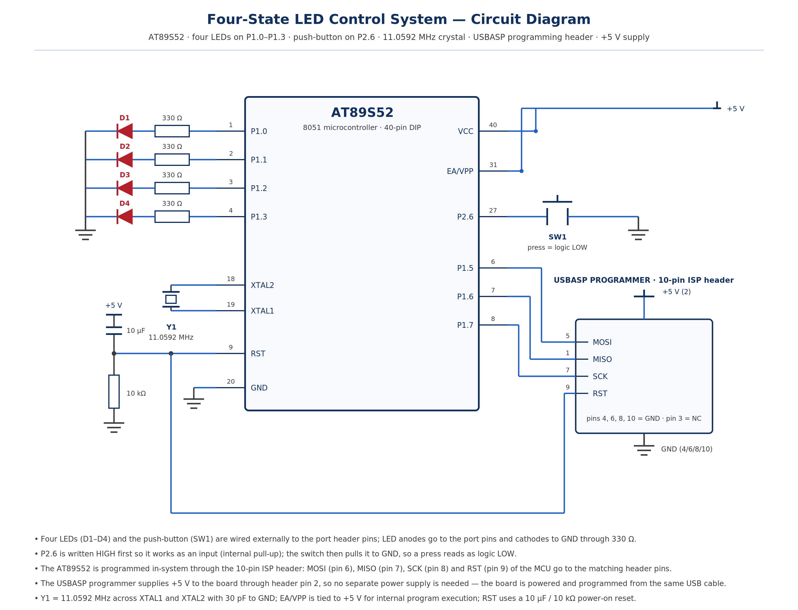

# EXPERIMENT DETAILS

**EXP:** CONTINUOUS ASSESMENT 3

**DATE:** 27/07/2026

**NAME OF EXP:** Timer-Based LED Pattern Generator and Button Interrupt Controller

**HARDWARE SETUP / PLATFORM:** 8051 Development Board with AT89S52 + Keil µVision4

---

## TASK 3 : Four-State LED Control System

### 1. Circuit Diagram

The experiment demonstrates a register-level GPIO controller in which four LEDs driven from Port 1 display one of four operating modes, and a push-button on P2.6 advances the system to the next mode on every valid press.

- **Development Board:** 8051 Development Board by AMOTECH LABS
- **Microcontroller IC:** AT89S52
- **GPIO Port:** Port 1 for the LED outputs, Port 2 for the push-button input
- **GPIO Pin:** P1.0, P1.1, P1.2, P1.3 drive LED1 to LED4; P2.6 reads the push-button
- **Peripheral:** Four LEDs with 330 Ω series resistors to GND, one push-button (active LOW) to GND
- **Power Supply:** 5V DC regulated supply from the development board
- **Ground:** common GND for the LED cathodes and for the push-button

### 2. Core Logic / Pseudocode / Code Base

**Working Principle:**

The lower nibble of Port 1 drives the four LEDs, and every write preserves the upper nibble by masking with 0xF0 and OR-ing the new pattern in, so only P1.0 to P1.3 change. The push-button on P2.6 is read as a digital input, which requires the pin to be written HIGH first because the 8051 ports have weak internal pull-ups; the switch pulls the pin to GND when it is pressed, so the logic is active LOW.

A single global variable `state` holds the current mode. The `button_pressed()` function debounces the contact with a 20 ms software delay and then waits for the button to be released before returning, so one physical press produces exactly one state change. Each valid press increments `state`, and the value wraps from 4 back to 1, with state 0 meaning all LEDs off.

The `switch` statement dispatches to one of four mode functions. `state_running()` shifts a single bit across the lower nibble, `state_counter()` displays a 4-bit binary count from 0 to 15, `state_alternating()` toggles between the patterns 0101 and 1010, and `state_all_flash()` alternates between all four LEDs on and all off. Each mode function keeps its position, count or toggle value in a `static` variable so that it continues from where it stopped, and paces itself with a 500 ms software delay.

**Pseudocode:**

1. Include the 8051 register definition header file.
2. Declare the push-button pin P2.6 as an input and the four LED pins as the lower nibble of Port 1.
3. Write a `delay_ms()` function using nested loops for software timing.

4. Write a `button_pressed()` function that checks P2.6, waits 20 ms, checks again to debounce, and then waits until the button is released before reporting one press.
5. Write `state_running()`: shift a single 1 across P1.0 to P1.3, advance the position, wrap after the fourth LED and delay 500 ms.
6. Write `state_counter()`: output a 4-bit count on P1.0 to P1.3, increment it, wrap after 15 and delay 500 ms.

7. Write `state_alternating()`: output 0101 and 1010 alternately on the lower nibble and delay 500 ms.
8. Write `state_all_flash()`: output 1111 and 0000 alternately on the lower nibble and delay 500 ms.
9. In `main()`, clear the lower nibble of Port 1 so all LEDs start OFF, and write P2.6 HIGH to configure it as an input.

10. In the main loop, call `button_pressed()`; on a valid press increment `state` and wrap it back to 1 after mode 4.
11. Dispatch on `state` to the matching mode function, keeping state 0 as the idle state with all LEDs off.
12. Repeat the loop continuously so that the current mode keeps running until the next press.

**Code Base:**

The program is written in Embedded C using Keil µVision with the C51 compiler, and the source file `switch_logic.c` is kept in this folder.

- `reg51.h` provides the 8051 register definitions.
- `sbit prt26 = P2^6;` names the push-button pin; the LEDs are driven directly through the `P1` port register.
- `delay_ms()` uses nested `for` loops to generate the software delay used for debouncing and for the 500 ms mode timing.
- `button_pressed()` performs the debounce and the release wait, and returns 1 only once per physical press.

- `state_running()`, `state_counter()`, `state_alternating()` and `state_all_flash()` implement the four modes, each keeping its own `static` variable.
- `P1 = (P1 & 0xF0) | pattern;` writes the lower nibble while leaving the upper nibble of Port 1 unchanged.
- `main()` initialises the ports and runs the `switch` state machine in an endless `while(1)` loop.

### 3. Inference

**NOTE : WE USED AN ONBOARD LED ON PORT 1.0 FOR OUR EXPERIMENT as D1 , YOU MAY USE AN EXTERNAL LED TOO.**

On reset all four LEDs stayed OFF, and each press of the push-button advanced the board by exactly one mode, with no double stepping or missed presses, which confirmed that the 20 ms debounce and the release wait together produced one state transition per physical press.

The four modes behaved as required: a single LED ran from LED1 to LED4 and repeated, the LEDs then displayed a binary count from 0000 to 1111, then the patterns 0101 and 1010 alternated, and finally all four LEDs flashed on and off together, each mode continuing until the next press.

The experiment demonstrates register-level GPIO control on the 8051, the use of the lower nibble of a port to drive four outputs while preserving the rest of the port, active-LOW switch input with software debouncing, and the use of a state machine to select between multiple operating modes.
