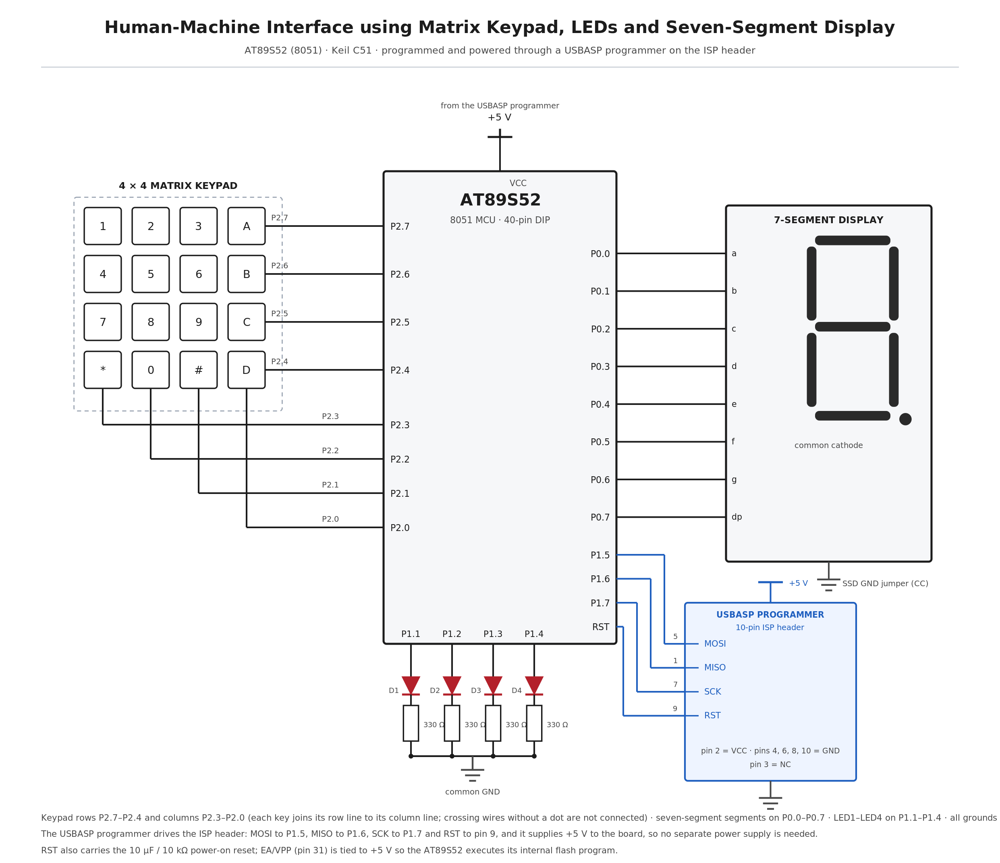

# EXPERIMENT DETAILS

**EXP:** CONTINUOUS ASSESMENT 4

**DATE:** 03/08/2026

**NAME OF EXP:** Human-Machine Interface using Matrix Keypad, LEDs, and Seven-Segment Display

**HARDWARE SETUP / PLATFORM:** 8051 Development Board (AT89S52) + Keil µVision4 , and downloaded with a USBASP USB ISP programmer through the board's 10-pin ISP header.

---

## TASK 4 : Human-Machine Interface using Matrix Keypad, LEDs, and Seven-Segment Display

### 1. Circuit Diagram

The experiment demonstrates a user interface in which the 4×4 matrix keypad acts as the input device, the seven-segment display gives visual feedback of the key pressed, and four LEDs indicate the selected operating mode.

- **Development Board:** 8051 Development Board by AMOTECH LABS
- **Microcontroller IC:** AT89S52 (40-pin DIP), 11.0592 MHz crystal
- **GPIO Port:** Port 1 for the LEDs, Port 2 for the keypad, Port 0 for the seven-segment display
- **GPIO Pin:** P1.1, P1.2, P1.3, P1.4 for LED1–LED4; P2.7–P2.4 as keypad rows and P2.3–P2.1 as keypad columns; P0.0–P0.7 for segments a–g and dp
- **Peripheral:** 4 external LEDs (anode to the port pin, cathode through a 330 Ω resistor), on-board 4×4 matrix keypad, on-board common-cathode seven-segment display
- **Power Supply:** +5 V DC from the USB Type-C connector
- **Ground:** common GND, with the SSD ground jumper inserted so the display common cathode is grounded



### 2. Core Logic / Pseudocode / Code Base

**Working Principle:**

The keypad on Port 2 is scanned one row at a time: the program drives a single row line low and reads the three column lines, so the low row and the low column together identify the key at their intersection. The decoded key value is translated through a common-cathode segment lookup table and written to Port 0, so the display shows the digit, and the same value is passed to the LED control routine on Port 1. Keys 1–4 latch one LED each, keys 5–8 run timed LED patterns that re-scan the keypad between steps, and keys 9 and 0 switch all LEDs off or reset the system. Because the patterns are executed as ordinary blocking loops, the keypad is only read at fixed points inside them.

**Pseudocode:**

```text
SEG[0..9]   ← {0x3F, 0x06, 0x5B, 0x4F, 0x66, 0x6D, 0x7D, 0x07, 0x7F, 0x6F}
ROW_MASK[0..3] ← {0x7F, 0xBF, 0xDF, 0xEF}
COL_BIT[0..2]  ← {0x08, 0x04, 0x02}
KEY[r][c]      ← {{1, 2, 3},
                  {4, 5, 6},
                  {7, 8, 9},
                  {⊥, 0, ⊥}}          ⊥ = not decoded (* and #)

NONE ← 0xFF


delay_ms(n):
    for i ← 1 to n
        for j ← 0 to 126
        end for
    end for


keypad_scan() → k:
    k ← NONE
    for r ← 0 to 3
        P2 ← ROW_MASK[r]
        for c ← 0 to 2
            if (P2 AND COL_BIT[c]) = 0 then
                k ← KEY[r][c]
                P2 ← 0xFF
                return k
            end if
        end for
    end for
    P2 ← 0xFF
    return k


display_digit(v):
    if v ≤ 9 then
        P0 ← SEG[v]
    else
        P0 ← 0x00
    end if


led_control(k):
    case k of
        1 : P1 ← 0x02
        2 : P1 ← 0x04
        3 : P1 ← 0x08
        4 : P1 ← 0x10
        5 : running_led()
        6 : alternate_led()
        7 : binary_counter()
        8 : blink_all()
        9 : P1 ← 0x00
        0 : reset()
    end case


running_led():
    PAT[0..5] ← {0x02, 0x04, 0x08, 0x10, 0x08, 0x04}
    for cycle ← 1 to 3
        for i ← 0 to 5
            P1 ← PAT[i]
            delay_ms(200)
            k ← keypad_scan()
            if k ≠ NONE AND k ≠ 5 then return
        end for
    end for


alternate_led():
    for i ← 1 to 10
        P1 ← 0x14
        delay_ms(250)
        k ← keypad_scan()
        if k ≠ NONE AND k ≠ 6 then return
        P1 ← 0x0A
        delay_ms(250)
        k ← keypad_scan()
        if k ≠ NONE AND k ≠ 6 then return
    end for


binary_counter():
    for i ← 0 to 15
        P1 ← i × 2                 ⊥ bits shifted into P1.1–P1.4
        delay_ms(400)
        k ← keypad_scan()
        if k ≠ NONE AND k ≠ 7 then return
    end for
    delay_ms(500)
    P1 ← 0x00


blink_all():
    for i ← 1 to 10
        P1 ← 0x1E
        delay_ms(500)
        k ← keypad_scan()
        if k ≠ NONE AND k ≠ 8 then return
        P1 ← 0x00
        delay_ms(500)
        k ← keypad_scan()
        if k ≠ NONE AND k ≠ 8 then return
    end for


reset():
    P1 ← 0x00
    P0 ← SEG[0]


main():
    P0 ← 0x00
    P1 ← 0x00
    P2 ← 0xFF
    k ← NONE
    last ← NONE

    loop forever
        if k = NONE OR k = last then
            k ← keypad_scan()
        end if

        if k ≠ NONE AND k ≠ last then
            last ← k
            display_digit(k)
            led_control(k)
        end if

        if k = NONE then
            last ← NONE
        end if
    end loop
```

**Code Base:**

The program is written in Embedded C and compiled with Keil C51 (µVision) for the AT89S52; the source file and the Keil project are kept in this folder.

- `reg51.h` provides the 8051 special function register definitions, so `P0`, `P1` and `P2` can be written as whole ports.
- The segment table is stored in program memory with the `code` qualifier instead of occupying internal RAM.
- `keypad_scan()` drives the row masks `0x7F`, `0xBF`, `0xDF`, `0xEF` onto `P2` and tests the column bits `0x08`, `0x04`, `0x02` with a bitwise AND.
- `delay_ms()` uses nested loops, counted to match the 1 ms loop used in the board vendor's own example programs.
- The functions `keypad_scan()`, `display_digit()`, `led_control()`, `running_led()`, `alternate_led()`, `binary_counter()` and `blink_all()` are implemented as separate functions, as the task sheet requires.
- Key state is held in the two global variables `key_pressed` and `last_key`, which together form an edge detector so that a held key is acted upon once and a released key re-arms it.

### 3. Inference

Every valid key press was shown on the seven-segment display and executed its LED function: keys 1–4 lit one LED each, keys 5–8 ran the running light, the alternation, the 0–15 binary counter and the all-LED blink, and key 9 and key 0 cleared the LEDs and reset the system.

While the running light pattern was executing, pressing another key had no effect; the pattern ran on to its end and the new key was acted upon only afterwards. The cause is that each pattern is written as a blocking loop which reads the keypad only between its delay steps, every 200 ms in the running light and up to 500 ms in the blink, so a press that begins and ends inside one of those delay windows is never seen and the main loop cannot service the keypad while the pattern is inside a delay. Key response in this design is therefore limited to the instants at which the keypad is re-scanned, and a running pattern can be interrupted only at those instants, never in the middle of a delay.

The LEDs, wired with their anodes on P1.1–P1.4 and a common ground, glowed only dimly, and the multimeter showed the port pin voltage well below 5 V while it was driving an LED, confirming that an 8051 port pin sources only a weak current and sinks far better than it sources.

The experiment therefore demonstrates matrix keypad scanning, seven-segment decoding, and blocking sequential control on the 8051, together with the practical limit that direct port drive places on the current available to an output load.