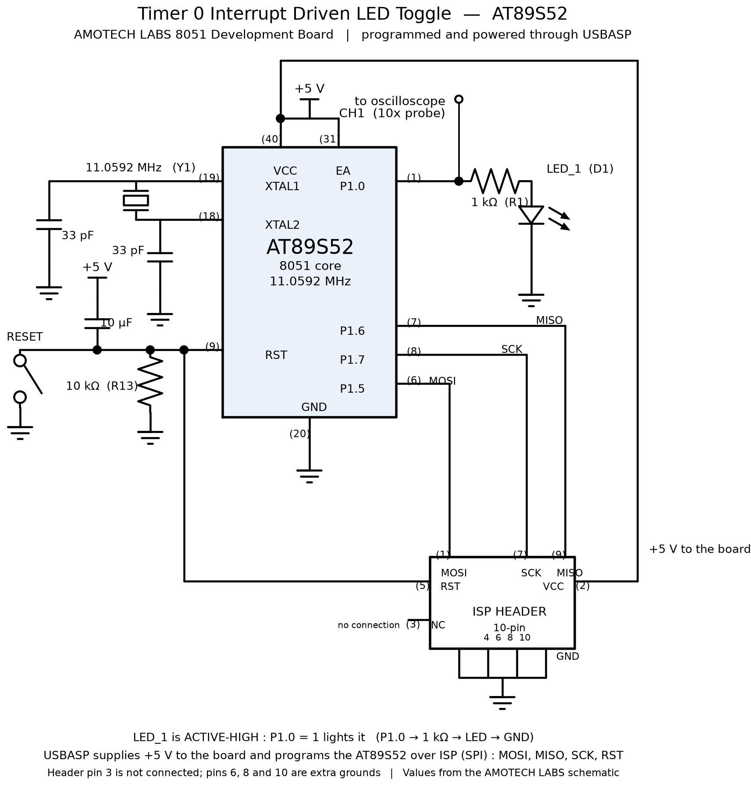

# EXPERIMENT DETAILS

**EXP:** CONTINUOUS ASSESMENT 5

**DATE:** 10/08/2026

**NAME OF EXP:** Hardware Timer and Interrupt-Based Timing for LED Fading, Pulse Generation, and Stepper Motor Control

**HARDWARE SETUP / PLATFORM:** 8051 Development Board - AT89S52 microcontroller running at 11.0592 MHz, coded in Keil µVision4 (C51 compiler).

---

## TASK 1 : Timer 0 Periodic Interrupt and 1-Second LED Toggle

### 1. Circuit Diagram

The experiment demonstrates that an on-chip hardware timer, not a software delay loop, can act as the time base of an embedded system. Timer 0 is loaded with a preload value so that it overflows at a fixed interval, and the overflow interrupt toggles an LED that is driven active-high from P1.0. The AT89S52 runs from the on-board 11.0592 MHz crystal (Y1), loaded by two 33 pF capacitors, and that crystal frequency is what fixes the machine-cycle time used in the calculations below. The USBASP programmer is shown connected to the ISP header because it serves double duty here: it downloads the hex file into the chip and it supplies the board's +5 V rail while doing so. The square wave produced on the LED pin is observed on an oscilloscope to confirm the period.

- **Development Board:** 8051 development board
- **Microcontroller IC:** AT89S52
- **GPIO Port:** Port 1 (P1)
- **GPIO Pin:** P1.0
- **Peripheral:** On-board LED_1 (D1), driven from P1.0 through a 1 kΩ series resistor (R1) to ground — active-high, so the LED is ON when P1.0 = 1 and OFF when P1.0 = 0. Oscilloscope probe on P1.0.
- **Power Supply:** +5 V DC — taken from the USBASP programmer over the ISP header while programming, or from the board's USB Type-C connector when the programmer is not attached
- **Ground:** common GND




### 2. Core Logic / Pseudocode / Code Base

**Working Principle:**

Timer 0 is configured in Mode 1, which makes it a 16-bit up-counter that counts internal machine cycles. Instead of starting from 0, it is preloaded with the value `0xDC00`, so it has only 9216 counts left before it rolls over past `0xFFFF`. On overflow the hardware sets the TF0 flag and vectors the CPU to the Timer 0 interrupt service routine. 

The ISR reloads the preload value and increments a counter; every time that counter reaches its limit, the ISR toggles P1.0. Because the interval is produced by the crystal-driven timer, the LED period is independent of how long the rest of the program takes to execute — the main loop contains no delay loop at all and simply puts the CPU into idle mode.

**Timer 0 Mathematics — explained as simply as possible:**

Think of the timer as a bucket that can hold exactly 65536 drops of water. Every machine cycle, one drop falls in. When the bucket is full it spills over — that spill is the interrupt. You do not want to wait for all 65536 drops every time, so you start the bucket already partly full. That head start is the *preload*.

1. **How fast does the water drip?** The crystal runs at 11.0592 MHz, i.e. 11,059,200 ticks per second. The classic 8051 divides that by 12 to get one machine cycle:

   $$T_{machine} = \frac{12}{f_{crystal}} = \frac{12}{11{,}059{,}200} \approx 1.085\ \mu s$$

   So one drop falls into the bucket roughly every 1.085 microseconds.

2. **How many drops are left after the preload?** The timer counts up to 65536 and then overflows. If we load `0xDC00`, that is 56320 in decimal. So the timer still has to count:

   $$N = 65536 - 56320 = 9216\ \text{counts}$$

3. **How much time is that?** Multiply the number of drops by the time per drop:

   $$t = 9216 \times \frac{12}{11{,}059{,}200} = \frac{110{,}592}{11{,}059{,}200} = 0.01\ s = 10\ ms$$

   The numbers cancel out beautifully, which is exactly why 11.0592 MHz is chosen for 8051 boards — it makes the arithmetic come out to clean round values. Each Timer 0 overflow therefore happens **exactly every 10 milliseconds**.

4. **How do we get 1 second out of 10 milliseconds?** One interrupt is only a small slice. Count the slices:

   $$\text{interrupts needed} = \frac{1\ s}{10\ ms} = 100$$

   So the ISR must count **100 overflows** before it toggles the LED. Because the LED *toggles* (turns on, then off), one full on-off blink cycle takes 2 seconds.

5. **Putting the two together.** One interrupt arrives every 10 ms, and the ISR counts 100 of them before it touches the LED:

   $$100 \times 10\ ms = 1000\ ms = 1\ s$$

   So P1.0 toggles once every second. Since a toggle is only half a blink, the LED's full on-off cycle is 2 seconds and the square wave on the pin has a frequency of 0.5 Hz — exactly the 1-second toggle the task sheet specifies.

**Pseudocode:**

```
/* global : k ← 0 */

TIMER0_ISR()                  // entered automatically on every Timer 0 overflow
1   TL0 ← 0x00                // reload low byte of the preload
2   TH0 ← 0xDC                // reload high byte of the preload
3   TF0 ← 0                   // clear the overflow flag
4   k ← k + 1                 // one more 10 ms tick has elapsed
5   if k ≥ 100 then           // 100 × 10 ms = 1 s
6       P1.0 ← NOT P1.0       // toggle the LED
7       k ← 0
8   end if
9   return

MAIN()
1   TMOD ← 0x01               // Timer 0, Mode 1 : 16-bit timer, internal clock
2   TL0 ← 0x00                // preload low byte  (0xDC00 = 56320)
3   TH0 ← 0xDC                // preload high byte
4   TR0 ← 1                   // start Timer 0
5   ET0 ← 1                   // unmask the Timer 0 overflow interrupt
6   EA ← 1                    // enable interrupts globally
7   k ← 0                     // clear the software time base
8   while TRUE do
9       PCON ← PCON OR 0x01   // idle the CPU; the timer keeps counting
10  end while
```

**Code Base:**

The code is built in Keil µVision with the C51 compiler and targets the AT89S52. It uses `reg51.h` for the SFR definitions, `sbit P1_0 = P1^0;` to name the LED pin, the Keil C51 `interrupt 1` keyword to attach the ISR to the Timer 0 overflow vector, and bit operations on `P1_0` to drive the LED. There is no delay function in the active code path — all timing comes from the hardware timer.

**Timer 0 configuration, register by register (Keil µVision):**

There is no code generator on the 8051. Every decision about the timer is made by writing Special Function Registers directly in `main()`, before the `while(1)` loop. Each line of the program below maps to one of those decisions, and each register is simply a named byte inside the AT89S52 that the compiler already knows about through `reg51.h`.
'''

- **`TMOD = 0x01;` — choosing the timer and its mode.** TMOD is split into two nibbles, the high nibble for Timer 1 and the low nibble for Timer 0. `0x01` is `0000 0001`, so the low nibble is `0001` and reads as three separate choices: GATE0 = 0, so the timer runs freely and is not gated by the INT0 pin; C/T0 = 0, so it counts internal machine cycles (timer mode) rather than pulses arriving on the T0 pin; and M1:M0 = 01, which selects Mode 1, a 16-bit counter. The high nibble stays zero because Timer 1 is not used in this experiment.

- **`TH0 = 0xDC; TL0 = 0x00;` — setting the period.** Timer 0 in Mode 1 is one 16-bit register split across two bytes, TH0 holding the upper eight bits and TL0 the lower eight. Writing `0xDC` and `0x00` loads the value `0xDC00`, which is 56320 in decimal. This preload is what fixes the 10 ms interval worked out above: the timer only has 9216 counts left before it overflows. Both bytes must be reloaded inside the ISR as well, because Mode 1 does not reload itself — the timer simply continues from zero after overflow if you let it.

- **`TR0 = 1;` — starting the timer.** TR0 is the run/stop control bit for Timer 0, held in the TCON register. Clearing it stops the counter; setting it lets the counter advance on every machine cycle. Nothing is timed until this bit is set.

- **`ET0 = 1;` — unmasking this specific interrupt.** ET0 lives in the IE register and enables the Timer 0 overflow as an interrupt source. Without it the timer would still overflow and set TF0, but the CPU would never be diverted into the ISR.

- **`EA = 1;` — the master switch.** EA is the global interrupt enable, also in IE. No interrupt of any kind reaches the CPU until EA is set, no matter what ET0 or any other individual enable bit says. Both bits are needed together: ET0 chooses *which* interrupt, EA decides *whether* interrupts happen at all.

- **`void timer0_isr(void) interrupt 1` — binding the handler.** The number after the `interrupt` keyword is the vector number, and vector 1 is the Timer 0 overflow vector, located at program address `0x000B` in the 8051's interrupt table. Keil C51 plants a jump to this function at that address and automatically saves and restores any registers the handler uses. Inside the handler, `TF0 = 0;` clears the overflow flag so the next overflow can be recognised, and `TL0` and `TH0` are reloaded to begin the next 10 ms window.

- **`PCON |= 0x01;` — idling the CPU.** Bit 0 of PCON is the IDL bit. Setting it puts the CPU into idle mode, where the clock to the CPU core is stopped but the timers and the interrupt system keep running. The CPU wakes on each Timer 0 interrupt, services it, returns, and idles again. This is what makes the design non-blocking: the main loop performs no work at all, yet the timing still holds exactly.

'''

### 3. Inference

The LED on P1.0 changes state once per second, at a fixed interval generated entirely by Timer 0 hardware, with no software delay loop anywhere in the active code path. The main loop only sets the idle bit, so the CPU sleeps between interrupts and the timing remains unaffected by instruction execution time. Observing the square wave on P1.0 with the oscilloscope confirms the period calculated from the preload value, demonstrating the sheet's principle that the hardware generates the timing while the software only responds to the timing event.


