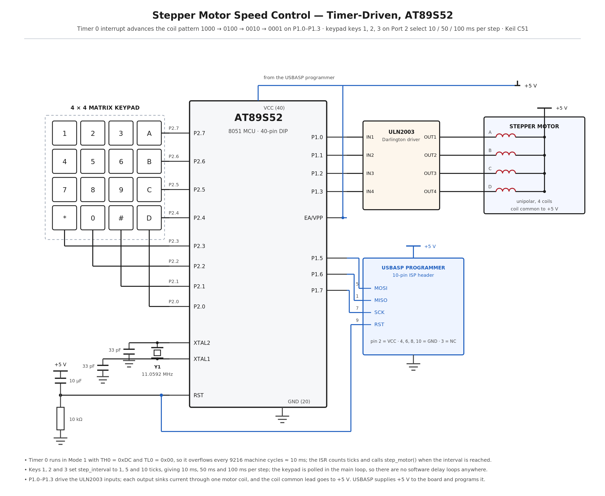

# EXPERIMENT DETAILS

**EXP:** CONTINUOUS ASSESMENT 5

**DATE:** 10/08/2026

**NAME OF EXP:** Hardware Timer and Interrupt-Based Timing for LED Fading, Pulse Generation, and Stepper Motor Control

**HARDWARE SETUP / PLATFORM:** 8051 Development Board with AT89S52 + Keil µVision (C51) programmed and powered through a USBASP programmer, unipolar stepper motor driven through a ULN2003 driver on P1.0–P1.3, 4×4 matrix keypad on Port 2, 11.0592 MHz crystal

---

## TASK 3 : Stepper Motor Speed and Direction Control

### 1. Circuit Diagram

The experiment demonstrates a timer-interrupt-driven stepper motor controller in which the AT89S52 energizes the four motor coils one at a time in the sequence 1000, 0100, 0010, 0001, and the interval between steps, set from the keypad, decides how fast the shaft turns.

- **Development Board:** 8051 development board with a 40-pin DIP microcontroller socket and an ISP programming header
- **Microcontroller IC:** AT89S52
- **GPIO Port:** Port 1 for the four motor coil outputs, Port 2 for the keypad
- **GPIO Pin:** P1.0, P1.1, P1.2, P1.3 drive coils 1 to 4 through the driver; P2.7–P2.4 are the keypad rows and P2.3–P2.0 the keypad columns
- **Peripheral:** Unipolar stepper motor with a ULN2003 Darlington driver board, and a 4×4 matrix keypad whose keys 1, 2 and 3 select the speed
- **ISP Programming:** USBASP programmer on the 10-pin ISP header — MOSI to P1.5 (pin 6), MISO to P1.6 (pin 7), SCK to P1.7 (pin 8) and RST to pin 9
- **Oscillator:** 11.0592 MHz crystal across XTAL1 (pin 19) and XTAL2 (pin 18), with 33 pF to GND on each side
- **Power Supply:** +5 V taken from the USBASP programmer through header pin 2; the motor coil common is also fed from +5 V; EA/VPP (pin 31) tied to +5 V; RST (pin 9) with a 10 µF / 10 kΩ power-on reset
- **Ground:** common GND for the driver board, the motor, the keypad and pin 20 (GND)

`circuit.png` is a reference sketch of the connections listed above; replace it with the Wokwi / Tinkercad capture or a hand-drawn diagram if the submission calls for one.

### 2. Core Logic / Pseudocode / Code Base

**Working Principle:**

Timer 0 is configured in Mode 1, 16-bit, and preloaded with TH0 = 0xDC and TL0 = 0x00, so it overflows after 9216 machine cycles. At 11.0592 MHz one machine cycle is 1.085 µs, which makes each overflow occur at about 10 ms, and that overflow raises the Timer 0 interrupt. The interrupt service routine reloads the timer, increments a software counter, and when the counter reaches `step_interval` it resets the counter and calls `step_motor()` to advance the motor by one step.

`step_motor()` holds a single HIGH bit in the global `coil` variable and rotates it right, wrapping from 0x01 back to 0x08, so exactly one of P1.0 to P1.3 is driven at a time in the sequence 1000, 0100, 0010, 0001. Writing `coil` to Port 1 turns the corresponding Darlington output on, which energizes that motor coil and moves the rotor one step.

The keypad scan runs in the main loop and is completely separate from the timing. Keys 1, 2 and 3 call `set_speed()`, which sets `step_interval` to 1, 5 or 10 timer ticks, that is about 10 ms, 50 ms or 100 ms per step, giving fast, medium and slow rotation. Because the step timing comes entirely from the timer interrupt and the keypad is polled in the main loop, there are no software delay loops anywhere and the keypad stays responsive at every speed.

**Pseudocode:**

1. Include the 8051 register definition header file.
2. Declare a software counter, the step interval, and the coil pattern variable initialised to 0x08.
3. Write `timer0_init()`: set TMOD to 0x01 for Timer 0 in Mode 1, preload TH0 = 0xDC and TL0 = 0x00, enable ET0 and EA, and start the timer with TR0.
4. Write the Timer 0 interrupt routine: reload TH0 and TL0, increment the counter, and when the counter reaches the step interval, clear the counter and call `step_motor()`.
5. Write `step_motor()`: rotate the single HIGH bit in the coil variable one place to the right, wrap 0x01 back to 0x08, and write the result to Port 1.
6. Write `set_speed()`: map key 1 to interval 1, key 2 to interval 5 and key 3 to interval 10.
7. Write `keypad_scan()`: drive one keypad row LOW at a time with the other rows HIGH, read the columns, and return the key value when a column reads LOW.
8. In `main()`, call `timer0_init()` and write the initial coil pattern to Port 1.
9. In the main loop, call `keypad_scan()`; if a valid key is returned, pass it to `set_speed()`.
10. Repeat the loop continuously, while the timer interrupt keeps stepping the motor in the background.

**Code Base:**

The program is written in Embedded C using Keil µVision with the C51 compiler, and the source file `main.c` is kept in this folder.

- `reg51.h` provides the 8051 register definitions.
- `timer0_init()` sets `TMOD = 0x01` for Timer 0 Mode 1, preloads `TH0 = 0xDC` and `TL0 = 0x00` for a 10 ms tick, and enables `ET0`, `EA` and `TR0`.
- `timer0_ISR()` declared as `interrupt 1` reloads the timer, counts ticks and calls `step_motor()` once the step interval has elapsed.
- `step_motor()` rotates the single HIGH bit in `coil` with a right shift and writes it to `P1`, producing the one-phase-on sequence 1000 to 0001.
- `set_speed()` maps the keypad keys 1, 2 and 3 to step intervals of 1, 5 and 10 ticks.
- `keypad_scan()` drives the rows on P2.7–P2.4 and reads the columns on P2.3–P2.0 to decode the pressed key.
- `main()` initialises the timer, sets the first coil pattern on Port 1 and polls the keypad in an endless `while(1)` loop.

### 3. Inference

The motor stepped continuously as soon as the program started, advancing one coil at a time in the order 1000, 0100, 0010, 0001 and then repeating, which confirmed that the Timer 0 interrupt was generating the step pulses and that the one-phase-on sequence on P1.0 to P1.3 was driving the motor correctly.

Pressing key 1, 2 or 3 on the keypad changed the interval between steps to about 10 ms, 50 ms and 100 ms, so the shaft ran fast, medium and slow respectively, and the keypad responded immediately at every speed because the step timing was produced by the timer interrupt rather than by a software delay loop.

The experiment demonstrates the use of a hardware timer as a system time base, a non-blocking interrupt-driven control loop, and the generation of a stepper motor drive sequence on a port while the main program continues to service an input device.
