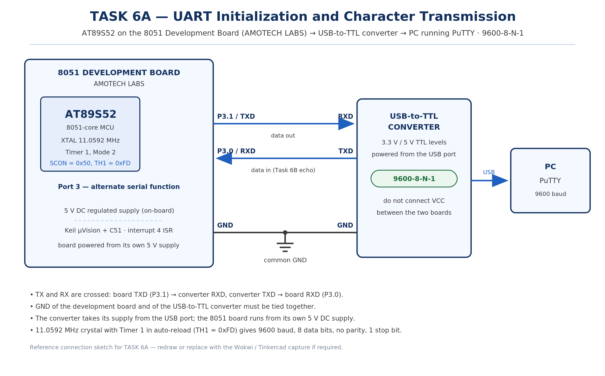

# EXPERIMENT DETAILS

**EXP:** CONTINUOUS ASSESMENT 6

**DATE:** 17/08/2026

**NAME OF EXP:** UART Driver and Serial Debugging

**HARDWARE SETUP / PLATFORM:** 8051 Development Board by AMOTECH LABS with AT89S52 + Keil µVision + USB-to-TTL Converter with PuTTY on PC (9600-8-N-1)

---

## TASK 6A : UART Initialization and Character Transmission

### 1. Circuit Diagram

The experiment demonstrates interrupt-driven UART transmission from the 8051 to a PC terminal, with the serial port configured for 9600-8-N-1 communication over a USB-to-TTL serial interface.

- **Development Board:** 8051 Development Board by AMOTECH LABS
- **Microcontroller IC:** AT89S52
- **GPIO Port:** Port 3 (alternate serial function)
- **GPIO Pin:** P3.1 (TXD) to RXD of the USB-to-TTL converter; P3.0 (RXD) from TXD of the converter
- **Peripheral:** USB-to-TTL serial converter connected to a PC running PuTTY
- **Power Supply:** 5V DC regulated supply from the development board
- **Ground:** common GND shared between the development board and the USB-to-TTL converter

`circuit.png` is a reference sketch of the connections listed above; replace it with the Wokwi / Tinkercad capture or a hand-drawn diagram if the submission calls for one.

### 2. Core Logic / Pseudocode / Code Base

**Working Principle:**

The AT89S52 serial port is configured in Mode 1, 8-bit asynchronous UART, by loading SCON with 0x50, which also enables reception. Timer 1 is run in Mode 2, 8-bit auto-reload, to generate the baud-rate clock; with the 11.0592 MHz crystal the reload value TH1 = 0xFD gives 9600 baud, so one start bit, eight data bits, no parity and one stop bit form each frame.

Writing a character to SBUF starts transmission, and the hardware sets the transmit flag TI once the stop bit has been shifted out. The serial interrupt service routine clears TI and loads the next character from the message buffer, so the string is sent one character at a time while the CPU remains free between interrupts.

**Pseudocode:**

1. Include the 8051 register definition header file.
2. Store the character string to be transmitted in a message array.
3. Configure Timer 1 in Mode 2 (8-bit auto-reload).
4. Load TH1 and TL1 with 0xFD for 9600 baud at 11.0592 MHz.
5. Load SCON with 0x50 to select UART Mode 1 and enable reception.
6. Start Timer 1 by setting TR1.
7. Clear the transmit flag TI.
8. Enable the global interrupt EA and the serial interrupt ES.
9. Write the first character of the message to SBUF to begin transmission.
10. In the serial ISR, check TI; if set, clear it and load the next character into SBUF.
11. When the null terminator is reached, set a transmission-complete flag and stop sending.
12. Keep the main loop free for other work while the interrupt routine handles each character.

**Code Base:**

The program is written in Embedded C using Keil µVision with the C51 compiler, and the source file is kept in this folder.

- `reg52.h` provides the 8051 SFR definitions.
- `uart_init()` configures `SCON = 0x50`, `TMOD` for Timer 1 Mode 2, `TH1` / `TL1` = `0xFD`, starts `TR1`, clears `TI` and enables `EA` and `ES`.
- `serial_ISR()` declared as `interrupt 4` handles the serial interrupt and reloads `SBUF` character by character.
- `char message[]` holds the string to be transmitted and `tx_index` tracks the current character.
- `main()` calls `uart_init()` and writes the first character to `SBUF` to start the transfer.

### 3. Inference

The message held in `message[]` was displayed in the PuTTY terminal at 9600 baud with 8 data bits, no parity and 1 stop bit, and no garbled or missing characters appeared, which confirmed that the serial port and the baud rate generated by Timer 1 were correct.

The characters were sent one at a time: each time the transmit flag TI was set by the hardware, the serial interrupt routine cleared it and loaded the next character into SBUF, so the CPU stayed free between interrupts and the transfer ended at the null terminator.

The experiment demonstrates interrupt-driven UART transmission on the 8051, the use of SCON and Timer 1 Mode 2 for 9600-8-N-1 communication, and the role of the TI flag and the serial interrupt in completing a character transmission.
