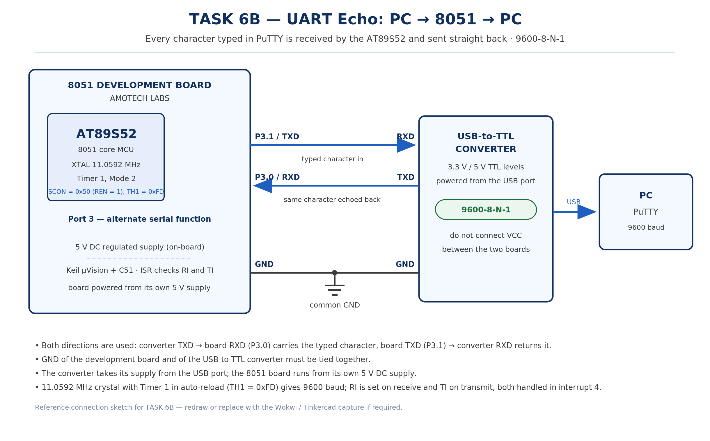

# EXPERIMENT DETAILS

**EXP:** CONTINUOUS ASSESMENT 6

**DATE:** 17/08/2026

**NAME OF EXP:** UART Driver and Serial Debugging

**HARDWARE SETUP / PLATFORM:** 8051 Development Board by AMOTECH LABS with AT89S52 + Keil µVision + USB-to-TTL Converter with PuTTY on PC (9600-8-N-1)

---

## TASK 6B : UART Echo

### 1. Circuit Diagram

The experiment demonstrates interactive two-way serial communication: a character typed in the PuTTY terminal travels over the USB-to-TTL converter into the 8051 receive pin, is read by the serial interrupt routine, and is transmitted straight back so the same character reappears on the PC (PC to 8051 to PC).

- **Development Board:** 8051 Development Board by AMOTECH LABS
- **Microcontroller IC:** AT89S52
- **GPIO Port:** Port 3 (alternate serial function)
- **GPIO Pin:** P3.0 (RXD) from TXD of the USB-to-TTL converter; P3.1 (TXD) to RXD of the USB-to-TTL converter
- **Peripheral:** USB-to-TTL serial converter connected to a PC running PuTTY
- **Power Supply:** 5V DC regulated supply from the development board
- **Ground:** common GND shared between the development board and the USB-to-TTL converter

`circuit.png` is a reference sketch of the connections listed above; replace it with the Wokwi / Tinkercad capture or a hand-drawn diagram if the submission calls for one.

### 2. Core Logic / Pseudocode / Code Base

**Working Principle:**

The serial port is set up exactly as in Task 6A, with SCON loaded with 0x50 to select UART Mode 1 and, in addition, to set the receive enable bit REN so the 8051 is able to listen on P3.0. Timer 1 in Mode 2 with TH1 = 0xFD generates the 9600 baud clock from the 11.0592 MHz crystal, so each frame is one start bit, eight data bits, no parity and one stop bit.

When a complete frame has been received, the hardware sets the receive flag RI and raises the serial interrupt. The interrupt routine checks RI, clears it, reads the received byte out of SBUF into a local variable, and immediately writes that same byte back into SBUF, which starts its transmission; when the byte has gone out, the hardware sets TI and the same routine clears it. Because both the receive and transmit flags are serviced inside the one interrupt routine, every character typed in PuTTY is echoed back without the main loop doing any polling.

**Pseudocode:**

1. Include the 8051 register definition header file.
2. Configure Timer 1 in Mode 2 (8-bit auto-reload).
3. Load TH1 and TL1 with 0xFD for 9600 baud at 11.0592 MHz.
4. Load SCON with 0x50 to select UART Mode 1 and set REN to enable reception.
5. Start Timer 1 by setting TR1.
6. Clear the transmit flag TI and the receive flag RI.
7. Enable the global interrupt EA and the serial interrupt ES.
8. Declare an unsigned character variable to hold the received byte.
9. Let the main loop stay idle, since the UART is driven entirely by interrupts.
10. In the serial ISR, check RI; if it is set, clear RI and read the received byte from SBUF into the variable.
11. Write the same byte back to SBUF so that it is transmitted to the PC.
12. Check TI; if it is set, clear it to mark the end of that character's transmission.
13. Repeat for every character typed in PuTTY, so the terminal displays the same text that was typed.

**Code Base:**

The program is written in Embedded C using Keil µVision with the C51 compiler, and the source file is kept in this folder.

- `reg52.h` provides the 8051 SFR definitions.
- `uart_init()` configures `SCON = 0x50` (Mode 1 with `REN = 1`), `TMOD` for Timer 1 Mode 2, `TH1` / `TL1` = `0xFD`, starts `TR1`, clears `TI` and `RI`, and enables `EA` and `ES`.
- `serial_ISR()` declared as `interrupt 4` handles both flags: on `RI` it reads `SBUF` into a character variable and writes it back to `SBUF` to echo it, and on `TI` it clears the flag.
- `main()` calls `uart_init()` and then idles, since all the transfer work happens in the interrupt routine.

### 3. Inference

Characters typed into the PuTTY terminal appeared back on the same terminal as they were typed, so the text entered (for example ABC123) was reproduced exactly, with no missing or duplicated characters, at 9600 baud with 8 data bits, no parity and 1 stop bit.

The echo confirmed both halves of the driver at once: the receive path worked because REN was set and the interrupt routine was entered on RI, and the transmit path worked because the byte read from SBUF was written straight back and the TI flag was cleared when the transmission finished.

The experiment demonstrates that the 8051 serial port can receive and transmit through the same interrupt vector, and that a single interrupt-driven driver is enough to make the link interactive with a PC terminal.
