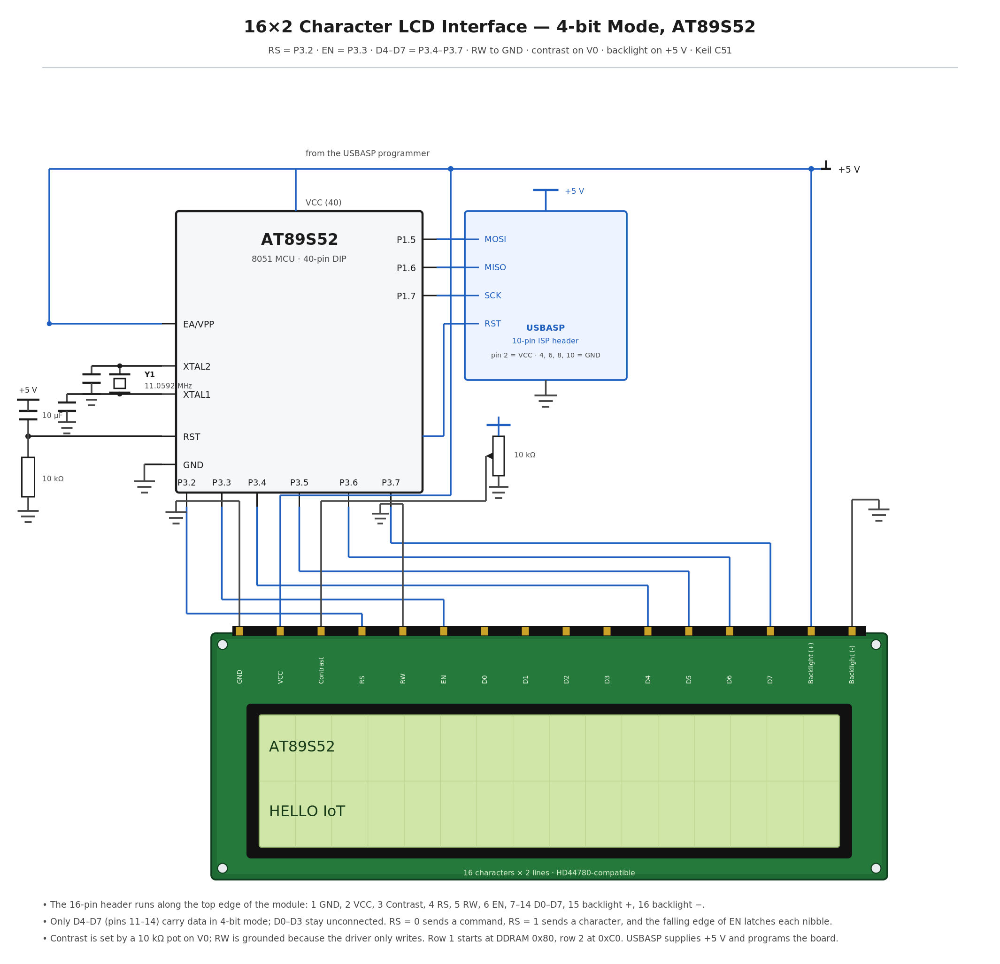

# EXPERIMENT DETAILS

**EXP:** CONTINUOUS ASSESMENT 7

**DATE:** 24/08/2026

**NAME OF EXP:** 16×2 LCD Driver Development and Dynamic Display Control

**HARDWARE SETUP / PLATFORM:** 8051 Development Board with AT89S52 + Keil µVision (C51) programmed and powered through a USBASP programmer, 16×2 HD44780-compatible character LCD in 4-bit mode, 11.0592 MHz crystal

---

## TASK 7A : LCD Initialization and Character/String Display

### 1. Circuit Diagram

The experiment demonstrates a 4-bit GPIO-based LCD driver in which the AT89S52 initialises an HD44780-compatible 16×2 display, writes individual characters on the first row and a character string on the second row, holding the text on screen afterwards.

- **Development Board:** 8051 development board with a 40-pin DIP microcontroller socket and an ISP programming header
- **Microcontroller IC:** AT89S52
- **GPIO Port:** Port 3, used as a 4-bit GPIO port for the LCD
- **GPIO Pin:** P3.2 to LCD RS, P3.3 to LCD E, P3.4 to LCD D4, P3.5 to D5, P3.6 to D6, P3.7 to D7; LCD RW is tied to GND
- **Peripheral:** 16×2 character LCD with an HD44780-compatible controller, operated in 4-bit, 2-line, 5×8 font mode
- **Contrast:** 10 kΩ potentiometer between +5 V and GND, with its wiper to the LCD V0 pin
- **Backlight:** LCD pins A and K are the backlight anode and cathode
- **ISP Programming:** USBASP programmer on the 10-pin ISP header — MOSI to P1.5 (pin 6), MISO to P1.6 (pin 7), SCK to P1.7 (pin 8) and RST to pin 9
- **Oscillator:** 11.0592 MHz crystal across XTAL1 (pin 19) and XTAL2 (pin 18), with 33 pF to GND on each side
- **Power Supply:** +5 V taken from the USBASP programmer through header pin 2, also feeding the LCD VDD and the backlight; EA/VPP (pin 31) tied to +5 V; RST (pin 9) with a 10 µF / 10 kΩ power-on reset
- **Ground:** common GND for the LCD VSS, RW and K pins, the potentiometer, pin 20 (GND) and the ISP header

`circuit.png` is a reference sketch of the connections listed above; replace it with the Wokwi / Tinkercad capture or a hand-drawn diagram if the submission calls for one.

### 2. Core Logic / Pseudocode / Code Base

**Working Principle:**

The LCD is wired for 4-bit operation, so only D4 to D7 carry data and every byte is transferred as two nibbles, the high nibble first and the low nibble second. RS selects what the byte means, low for a command and high for a character, and the falling edge of E latches each nibble into the LCD controller. Because RW is tied to GND the display is only ever written to, so the driver cannot poll the busy flag and instead waits a fixed delay after every command and character.

`lcd_init()` first waits 20 ms for the display to power up, then sends 0x30 three times with delays to force the controller into a known 8-bit state, sends 0x20 to switch it to 4-bit mode, and then issues the real configuration commands: 0x28 for 4-bit, 2-line, 5×8 font; 0x0F for display on with cursor and blink on; 0x06 for entry mode with the cursor moving right and no display shift; and 0x01 to clear the display and home the cursor.

In `main()` the driver writes the characters A, T, 8, 9, S, 5 and 2 one at a time, which fill the first row from the left because the cursor starts at DDRAM address 0x80. It then sends the command 0xC0 to move the cursor to the start of the second row and walks the character array "HELLO IoT" one element at a time until the null terminator, after which the program idles so the text stays visible.

**Pseudocode:**

1. Include the 8051 register definition header file.
2. Declare RS on P3.2 and E on P3.3 as bit-addressable pins, with D4–D7 taken from P3.4–P3.7.
3. Write a `delay_ms()` function using nested loops for the LCD timing delays.
4. Write `lcd_send_nibble()`: place the nibble on P3.4–P3.7 while leaving the lower bits of Port 3 unchanged, set E high, delay, set E low, delay.
5. Write `lcd_send_byte()`: send the high nibble first, then the low nibble.
6. Write `lcd_cmd()`: clear RS, send the byte, delay 2 ms.
7. Write `lcd_data()`: set RS, send the byte, delay 2 ms.
8. Write `lcd_init()`: wait 20 ms, send 0x30 three times with delays, send 0x20 to select 4-bit mode, then send 0x28, 0x0F, 0x06 and 0x01.
9. In `main()`, call `lcd_init()`.
10. Write the individual characters A, T, 8, 9, S, 5 and 2 with `lcd_data()` so they appear on the first row.
11. Send the command 0xC0 to move the cursor to the start of the second row.
12. Write the characters of the string "HELLO IoT" one by one with `lcd_data()` until the null terminator.
13. Idle in an endless loop so the display keeps showing both rows.

**Code Base:**

The program is written in Embedded C using Keil µVision with the C51 compiler, and the source file is kept in this folder.

- `reg52.h` provides the 8051 register definitions.
- `sbit LCD_RS = P3^2;` and `sbit LCD_EN = P3^3;` name the control pins; the four data lines are driven through the Port 3 register.
- `lcd_send_nibble()` writes the nibble with `P3 = (P3 & 0x0F) | (nibble & 0xF0);` so the lower half of Port 3 is untouched, and then pulses E high and low.
- `lcd_send_byte()` splits a byte into its high and low nibbles and calls `lcd_send_nibble()` twice.
- `lcd_cmd()` and `lcd_data()` send a byte with RS low or high respectively, with a 2 ms delay afterwards.
- `lcd_init()` contains the HD44780 wake-up sequence 0x30, 0x30, 0x30, 0x20 followed by the configuration commands 0x28, 0x0F, 0x06 and 0x01.
- `main()` initialises the LCD, writes the seven characters on row 1, sends 0xC0 to reach row 2 and then writes the string `"HELLO IoT"` character by character.

### 3. Inference

After reset the display cleared and the characters A, T, 8, 9, S, 5 and 2 appeared in order on the first row starting from the leftmost position, which confirmed that the 4-bit initialisation sequence had placed the controller in 2-line mode and that RS, E and the D4–D7 nibble transfers were wired correctly.

The command 0xC0 then moved the cursor to the start of the second row, and the string "HELLO IoT" was displayed there, so the same driver functions handled both single characters and a null-terminated character array without any change.

The experiment demonstrates how a peripheral datasheet is turned into a working low-level driver: deriving the function-set, display-control and entry-mode command bytes, splitting each byte into two nibbles for a 4-bit bus, and using RS and E to distinguish commands from data and to latch them into the display.
