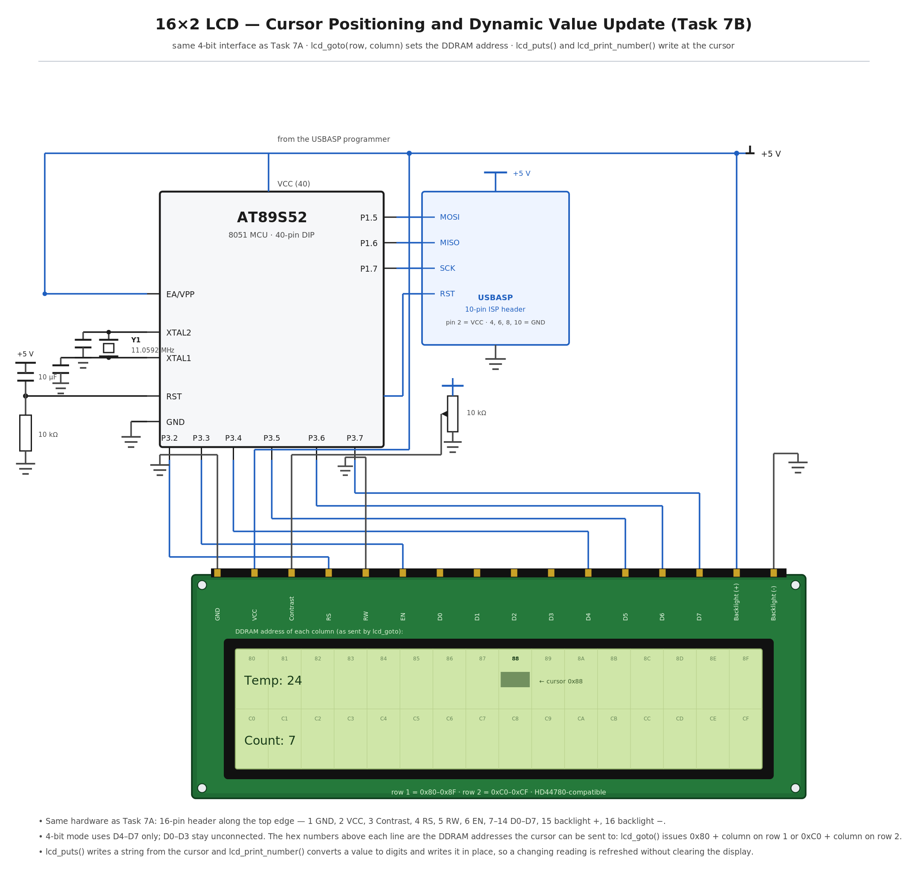

# EXPERIMENT DETAILS

**EXP:** CONTINUOUS ASSESMENT 7

**DATE:** 24/08/2026

**NAME OF EXP:** 16×2 LCD Driver Development and Dynamic Display Control

**HARDWARE SETUP / PLATFORM:** 8051 Development Board with AT89S52 + Keil µVision (C51) programmed and powered through a USBASP programmer, 16×2 HD44780-compatible character LCD in 4-bit mode, 11.0592 MHz crystal

---

## TASK 7B : Cursor Positioning and Dynamic Value Update

### 1. Circuit Diagram

The experiment uses the same 4-bit LCD interface as Task 7A: the AT89S52 drives the display through Port 3 and positions the cursor by sending DDRAM address commands, so strings and changing numeric values can be written at a chosen spot on either row.

- **Development Board:** 8051 development board with a 40-pin DIP microcontroller socket and an ISP programming header
- **Microcontroller IC:** AT89S52
- **GPIO Port:** Port 3, used as a 4-bit GPIO port for the LCD
- **GPIO Pin:** P3.2 to LCD RS, P3.3 to LCD E, P3.4 to LCD D4, P3.5 to D5, P3.6 to D6, P3.7 to D7; LCD RW is tied to GND
- **Peripheral:** 16×2 character LCD with an HD44780-compatible controller, operated in 4-bit, 2-line, 5×8 font mode
- **Contrast:** 10 kΩ potentiometer between +5 V and GND, with its wiper to the LCD V0 pin
- **Backlight:** LCD pins A and K are the backlight anode and cathode, fed from the +5 V rail
- **ISP Programming:** USBASP programmer on the 10-pin ISP header — MOSI to P1.5 (pin 6), MISO to P1.6 (pin 7), SCK to P1.7 (pin 8) and RST to pin 9
- **Oscillator:** 11.0592 MHz crystal across XTAL1 (pin 19) and XTAL2 (pin 18), with 33 pF to GND on each side
- **Power Supply:** +5 V taken from the USBASP programmer through header pin 2, also feeding the LCD VDD and the backlight; EA/VPP (pin 31) tied to +5 V; RST (pin 9) with a 10 µF / 10 kΩ power-on reset
- **Ground:** common GND for the LCD VSS, RW and K pins, the potentiometer, pin 20 (GND) and the ISP header

`circuit.png` is a reference sketch of the connections listed above; replace it with the Wokwi / Tinkercad capture or a hand-drawn diagram if the submission calls for one.

### 2. Core Logic / Pseudocode / Code Base

**Working Principle:**

The HD44780 keeps an address counter that points at the next character position in its display data RAM. Sending a command with the top bit set loads that counter directly, so `lcd_goto(row, column)` converts the requested position into a DDRAM address — 0x80 + column for the first row and 0xC0 + column for the second row — and sends it with RS low. The cursor jumps to that position and the next character written lands there, which means a field can be rewritten without clearing the whole display.

`lcd_puts(string)` writes a null-terminated string starting at the current cursor position by calling `lcd_data()` for each character until the terminator is reached. Because the entry mode was set to 0x06 in `lcd_init()`, the address counter increments after every write, so the characters appear in sequence without the driver having to reposition the cursor between them.

`lcd_print_number(value)` converts a numeric value into its decimal digits by repeated division and remainder by 10, adds the ASCII offset 0x30 to each digit and sends it with `lcd_data()`. The digits are written at the current cursor position, so a reading that changes over time can be refreshed by calling `lcd_goto()` to the field and then `lcd_print_number()` again — the old value is overwritten in place, which avoids the flicker and the lost text that a full clear command would cause.

**Pseudocode:**

1. Reuse the `lcd_init()`, `lcd_cmd()` and `lcd_data()` functions from Task 7A.
2. Write `lcd_goto(row, column)`: compute the address as 0x80 + column when row is 0, or 0xC0 + column when row is 1, then send it with `lcd_cmd()`.
3. Write `lcd_puts(string)`: step through the array from index 0 until the null terminator, sending each character with `lcd_data()`.
4. Write `lcd_print_number(value)`: extract the hundreds, tens and units digits using division and modulo by 10, add 0x30 to each digit and send them with `lcd_data()` in order.
5. In `main()`, call `lcd_init()`.
6. Call `lcd_goto(0, 0)` and `lcd_puts("Temp: ")` to place a fixed label at the start of the first row.
7. Call `lcd_goto(0, 6)` and `lcd_print_number(24)` so the value appears at a fixed field beside the label.
8. Call `lcd_goto(1, 0)` and `lcd_puts("Count: ")`, then `lcd_goto(1, 7)` and `lcd_print_number(7)` on the second row.
9. To update a value, call `lcd_goto()` back to the same column and call `lcd_print_number()` again, overwriting the previous digits instead of clearing the display.
10. Keep the program running so the displayed fields can be refreshed at any time.

**Code Base:**

The program is written in Embedded C using Keil µVision with the C51 compiler, and the source file is kept in this folder.

- `lcd_goto(row, column)` builds the DDRAM address as `0x80 + column` for row 0 and `0xC0 + column` for row 1, and passes it to `lcd_cmd()` so the address counter is loaded with the new position.
- `lcd_puts(string)` loops over a `unsigned char` array and calls `lcd_data()` until it meets `'\0'`.
- `lcd_print_number(value)` derives each decimal digit with `/` and `%` by 10, converts it to ASCII by adding `'0'`, and writes the digits with `lcd_data()` at the current cursor position.
- All three functions sit on top of the Task 7A driver, so the nibble splitting, the RS selection and the E pulse are unchanged.
- `main()` positions the cursor with `lcd_goto()` before each field, writes the fixed labels with `lcd_puts()` and writes the values with `lcd_print_number()`.

### 3. Inference

The label placed with `lcd_goto(0, 0)` and `lcd_puts()` appeared at the leftmost position of the first row, and the value written after `lcd_goto(0, 6)` appeared exactly six characters further along, which confirmed that the 0x80 + column address command moves the cursor to the intended DDRAM location.

The second row behaved the same way through the 0xC0 + column address, and calling `lcd_goto()` back to a field and writing a new number with `lcd_print_number()` replaced the old digits in place while the rest of the display stayed untouched and steady.

The experiment demonstrates direct control of the LCD's internal address counter, the difference between writing at a chosen position and clearing the screen, and the conversion of a numeric value into ASCII digits for display.
