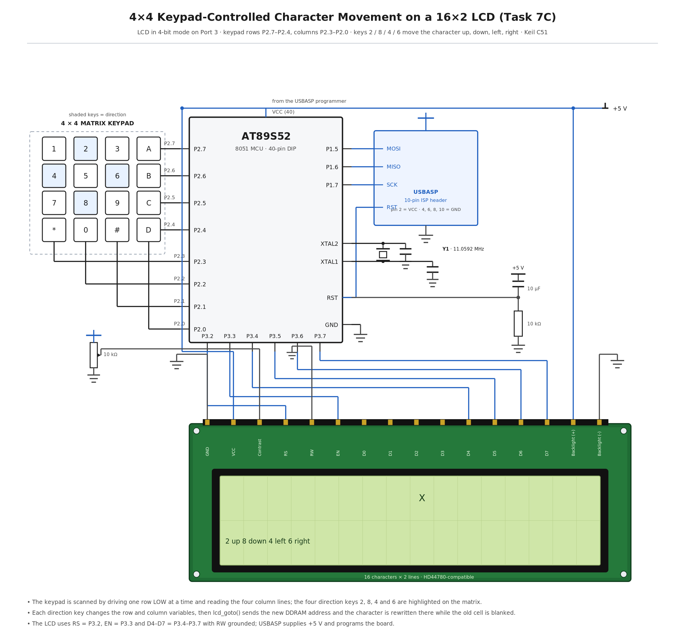

# EXPERIMENT DETAILS

**EXP:** CONTINUOUS ASSESMENT 7

**DATE:** 24/08/2026

**NAME OF EXP:** 16×2 LCD Driver Development and Dynamic Display Control

**HARDWARE SETUP / PLATFORM:** 8051 Development Board with AT89S52 + Keil µVision (C51) programmed and powered through a USBASP programmer, 16×2 HD44780-compatible character LCD in 4-bit mode, 4×4 matrix keypad on Port 2, 11.0592 MHz crystal

---

## TASK 7C : 4×4 Keypad-Based Character Movement

### 1. Circuit Diagram

The experiment demonstrates an interactive display in which a single character is moved across the 16×2 LCD with the four direction keys of a 4×4 matrix keypad, the LCD occupying Port 3 and the keypad Port 2 of the same AT89S52.

- **Development Board:** 8051 development board with a 40-pin DIP microcontroller socket and an ISP programming header
- **Microcontroller IC:** AT89S52
- **GPIO Port:** Port 3 for the LCD, Port 2 for the keypad
- **GPIO Pin:** P3.2 to LCD RS, P3.3 to LCD E, P3.4 to LCD D4, P3.5 to D5, P3.6 to D6, P3.7 to D7; keypad rows on P2.7–P2.4 and columns on P2.3–P2.0; LCD RW tied to GND
- **Peripheral:** 16×2 character LCD with an HD44780-compatible controller in 4-bit, 2-line mode, and a 4×4 matrix keypad whose keys 2, 8, 4 and 6 act as up, down, left and right
- **Contrast:** 10 kΩ potentiometer between +5 V and GND, with its wiper to the LCD V0 pin
- **Backlight:** LCD pins A and K are the backlight anode and cathode, fed from the +5 V rail
- **ISP Programming:** USBASP programmer on the 10-pin ISP header — MOSI to P1.5 (pin 6), MISO to P1.6 (pin 7), SCK to P1.7 (pin 8) and RST to pin 9
- **Oscillator:** 11.0592 MHz crystal across XTAL1 (pin 19) and XTAL2 (pin 18), with 33 pF to GND on each side
- **Power Supply:** +5 V taken from the USBASP programmer through header pin 2, also feeding the LCD VDD and the backlight; EA/VPP (pin 31) tied to +5 V; RST (pin 9) with a 10 µF / 10 kΩ power-on reset
- **Ground:** common GND for the LCD VSS, RW and K pins, the potentiometer, pin 20 (GND) and the ISP header

`circuit.png` is a reference sketch of the connections listed above; replace it with the Wokwi / Tinkercad capture or a hand-drawn diagram if the submission calls for one.

### 2. Core Logic / Pseudocode / Code Base

**Working Principle:**

The keypad is wired as a 4×4 matrix, so sixteen keys are read with eight port lines. The scanning routine drives one row line LOW at a time while the other rows stay HIGH, then reads the four column lines: if a key in that row is pressed, the corresponding column is pulled LOW through the closed contact, which identifies the key. A short delay after the first detection debounces the contact, and the routine waits for the key to be released before reporting it, so one press produces one move.

The character position is held in two variables, the row and the column, and the direction keys change them within the bounds of the display: key 2 decreases the row, key 8 increases it, key 4 decreases the column and key 6 increases it. After every accepted key the driver blanks the old cell, computes the new position and calls `lcd_goto(row, column)`, which sends the matching DDRAM address — 0x80 + column on the first row or 0xC0 + column on the second — and then writes the character again with `lcd_data()`.

Because the position is tracked in software and only the two affected cells are rewritten, the character appears to move across the screen without the display being cleared, and it stays inside the 16 columns and 2 rows because the row and column variables are clamped before the address is sent.

**Pseudocode:**

1. Reuse the `lcd_init()`, `lcd_cmd()`, `lcd_data()` and `lcd_goto()` functions from Tasks 7A and 7B.
2. Declare the current row and column of the character, and the character itself.
3. Write `keypad_scan()`: drive one row LOW with the other rows HIGH, read the four columns, and return the key value when a column reads LOW.
4. Debounce the detected key with a short delay and wait for release before returning the key.
5. Write `move_character()`: on key 2 decrement the row, on key 8 increment it, on key 4 decrement the column and on key 6 increment it.
6. Clamp the row to 0 to 1 and the column to 0 to 15 so the character cannot leave the display.
7. Blank the previous cell by calling `lcd_goto()` to the old position and writing a space.
8. Call `lcd_goto()` to the new position and write the character with `lcd_data()`.
9. In `main()`, initialise the LCD, place the character at its starting position and then loop forever.
10. In the loop, call `keypad_scan()`; when it returns one of the four direction keys, call `move_character()` and redraw the character.

**Code Base:**

The program is written in Embedded C using Keil µVision with the C51 compiler, and the source file is kept in this folder.

- `keypad_scan()` drives the row lines on P2.7–P2.4 and reads the column lines on P2.3–P2.0, returning the decoded key or a no-key value.
- The row and column position of the character are kept in two `unsigned char` variables that are updated by the direction keys and clamped to the display size.
- `lcd_goto(row, column)` supplies the DDRAM address for the new position, so the character is written at a chosen cell rather than after the previous character.
- `lcd_data()` writes the character itself, and a space written at the previous position erases the old cell.
- `main()` initialises the LCD, draws the character once and then polls the keypad in an endless `while(1)` loop.

### 3. Inference

Pressing key 6 moved the character one column to the right and key 4 moved it one column back, while keys 2 and 8 moved it between the two rows, and the rest of the display stayed unchanged because only the old and new cells were rewritten.

At the edges the character stopped instead of wrapping or disappearing, which confirmed that the row and column values were being clamped before the DDRAM address was computed, and a single press always produced a single move because the scan waits for the key to be released.

The experiment demonstrates matrix keypad scanning on a shared port, the coupling of an input device to a display through a position variable, and the use of DDRAM addressing to update individual cells of the LCD rather than redrawing the whole screen.
