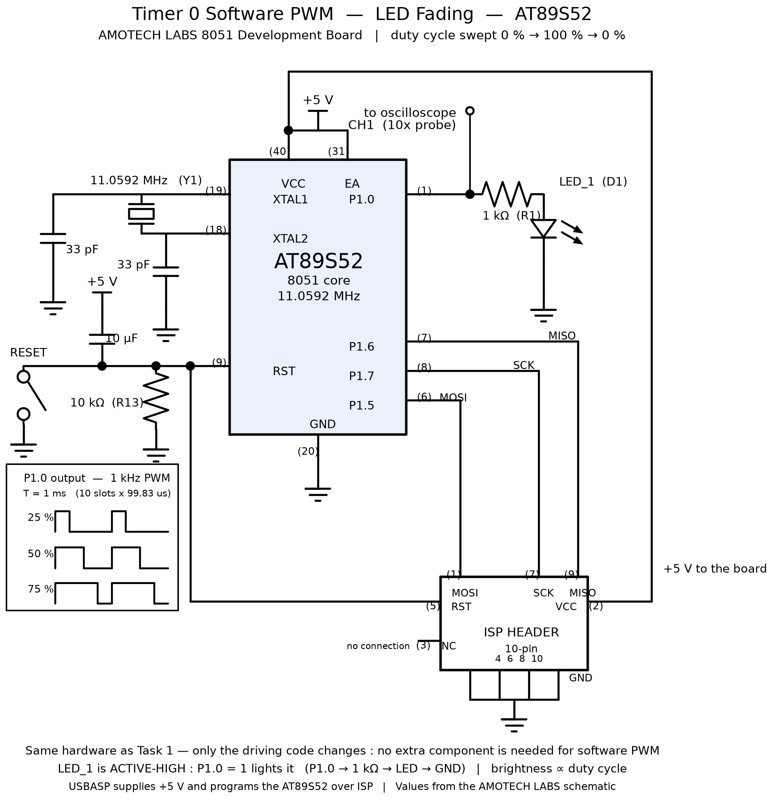

# EXPERIMENT DETAILS

**EXP:** CONTINUOUS ASSESMENT 5

**DATE:** 10/08/2026

**NAME OF EXP:** Hardware Timer and Interrupt-Based Timing for LED Fading, Pulse Generation, and Stepper Motor Control

**HARDWARE SETUP / PLATFORM:** 8051 Development Board by AMOTECH LABS — AT89S52 microcontroller running at 11.0592 MHz, coded in Keil µVision (C51 compiler) and downloaded with a USBASP USB ISP programmer through the board's 10-pin ISP header. One LED on port pin P1.0, oscilloscope probe on P1.0 to observe the PWM waveform.

---

## TASK 2 : Software PWM LED Fading

### 1. Circuit Diagram

The hardware is exactly the same as Task 1 — the same single LED on P1.0 — because software PWM needs no extra component at all. What changes is only the way the pin is driven: instead of toggling once a second, the Timer 0 interrupt now switches P1.0 on and off about a thousand times a second, and it slowly changes the fraction of each cycle that the pin stays on. The circuit therefore demonstrates that brightness control can be produced purely in software from one ordinary digital output pin, with no DAC and no analog parts.

- **Development Board:** 8051 development board by AMOTECH LABS
- **Microcontroller IC:** AT89S52
- **GPIO Port:** Port 1 (P1)
- **GPIO Pin:** P1.0
- **Peripheral:** On-board LED_1 (D1), driven from P1.0 through a 1 kΩ series resistor (R1) to ground — active-high, so the LED is ON when P1.0 = 1 and OFF when P1.0 = 0. Oscilloscope probe on P1.0 to observe the PWM waveform and its duty cycle.
- **Power Supply:** +5 V DC — taken from the USBASP programmer over the ISP header while programming, or from the board's USB Type-C connector when the programmer is not attached
- **Ground:** common GND



### 2. Core Logic / Pseudocode / Code Base

**Working Principle:**

Task 1 built a software time base: Timer 0 overflows at a fixed interval and the interrupt service routine counts those overflows. Task 2 keeps that same time base but uses it for something different. The PWM period is divided into ten equal slots, and each slot is one timer interrupt. Inside every interrupt the ISR looks at where it is within the current period and decides whether P1.0 should be high or low for that slot. A separate, slower counter changes the duty cycle after a fixed number of slots have passed, so the ratio of on-time to off-time walks slowly from 0 % up to 100 % and back down to 0 %. The LED never actually receives a variable voltage — it is switched hard on and hard off — but because the switching happens far faster than the eye can follow, it is perceived as a smoothly changing brightness.

**What PWM Actually Is — explained as simply as possible:**

Picture an ordinary light switch. Hold it on and the bulb is bright. Hold it off and it is dark. Now imagine flicking that switch on and off a thousand times every second, spending half of each flick on and half off. Your eye cannot follow anything that fast, so instead of seeing a strobing light you see one steady light at half brightness.

That is the whole idea of Pulse Width Modulation. A digital pin is only ever fully on (5 V) or fully off (0 V) — it cannot output 2.5 V. PWM fakes every level in between by changing how long the pin stays on during each cycle. Two numbers describe the waveform:

- **Period (T)** — how long one complete on-off cycle lasts. Its reciprocal is the **frequency**, f = 1/T.
- **Duty cycle (D)** — the fraction of that period the pin spends on, written as a percentage: D = t_on / T.

A duty cycle of 0 % means always off (dark), 100 % means always on (full brightness), and 50 % means on for half of every cycle (half brightness).

**The Mathematics Behind This PWM:**

1. **The machine cycle.** The crystal runs at 11.0592 MHz and the classic 8051 divides that by 12, so one machine cycle is

   $$T_{machine} = \frac{12}{f_{crystal}} = \frac{12}{11{,}059{,}200} \approx 1.085\ \mu s$$

   The timer counts these machine cycles, so this is the smallest step of time available.

2. **Choosing how often the interrupt fires.** One PWM period will be split into ten equal slots, and one slot equals one timer interrupt. To land near 1 kHz, each slot should be about 100 µs. The number of counts needed is

   $$N = \frac{100\ \mu s}{1.085\ \mu s} \approx 92.16 \rightarrow 92\ \text{counts}$$

   Since the timer counts up to 65536 before overflowing, it must be preloaded with

   $$65536 - 92 = 65444 = \text{FFA4}_{H}$$

   which means TH0 = 0xFF and TL0 = 0xA4. The slot that actually results is

   $$t_{slot} = 92 \times 1.085\ \mu s = 99.83\ \mu s$$

   The small difference from 100 µs is only the rounding of 92.16 down to a whole number of counts.

3. **The PWM period and frequency.** Ten slots make one PWM cycle:

   $$T_{PWM} = 10 \times 99.83\ \mu s = 998.3\ \mu s$$

   $$f_{PWM} = \frac{1}{T_{PWM}} \approx 1002\ Hz \approx 1\ kHz$$

   which sits inside the 500 Hz – 1 kHz band the task sheet suggests.

4. **How the duty cycle is produced.** A counter called `count` runs from 0 to 9 inside every period. In each interrupt the pin is driven high while `count` is below the value `duty`, and low once it is not:

   $$D = \frac{duty}{10} \rightarrow 0\%, 10\%, 20\%, \dots, 100\%$$

   Because there are ten slots, the smallest change of brightness is one slot, i.e. 10 %.

5. **Why it looks dimmer — the averaging.** The eye and the LED both respond to the average, not to the instantaneous value. Over one period the average voltage is

   $$V_{avg} = D \times V_{supply} = D \times 5\ V$$

   With a red LED dropping about 2 V and a 1 kΩ series resistor, the current while the pin is high is

   $$I_{on} = \frac{5\ V - 2\ V}{1000\ \Omega} = 3\ mA$$

   so the average current, which is what sets the perceived brightness, is

   $$I_{avg} = D \times 3\ mA$$

   At 0 % duty the LED is off and the current is 0 mA. At 50 % it averages 1.5 mA and the LED looks about half as bright. At 100 % it averages 3 mA and the LED is at full brightness. Notice that the peak current never changes — only the average does.

6. **Why 1 kHz and not, say, 20 Hz?** The human eye merges flicker above roughly 50–60 Hz, a limit called the flicker fusion threshold. Below that you would clearly see the LED strobing. At 1 kHz the switching is nearly twenty times faster than the eye can resolve, so the LED appears continuously illuminated rather than visibly flickering, which is exactly what the task sheet requires.

7. **Why only ten steps? The resolution trade-off.** Every slot costs one interrupt, so the interrupt rate is the PWM frequency multiplied by the number of steps:

   $$\text{interrupts per second} = f_{PWM} \times N_{steps}$$

   For ten steps at 1 kHz that is about 10,017 interrupts per second. The chip has 11,059,200 / 12 = 921,600 machine cycles available each second, and a typical C51 ISR takes roughly 40 machine cycles, so the load is

   $$\frac{10{,}017 \times 40}{921{,}600} \approx 43\%\ \text{of the CPU}$$

   Now try 1 % resolution, i.e. 100 steps, at the same 1 kHz. The slot would have to be 10 µs long, the interrupt rate would be 100,000 per second, and the cycle cost would be about 4,000,000 machine cycles per second — more than four times what the chip has. Worse, the ISR alone takes about 43 µs, which is already longer than the 10 µs slot it is supposed to fit into. So 1 % resolution at 1 kHz is physically impossible in software on this chip. Ten steps at 1 kHz is the practical compromise, and it is exactly the 10 % granularity the task sheet's example sequence asks for.

8. **How fast the fade runs.** The duty cycle is stepped once every 500 slots:

   $$500 \times 99.83\ \mu s = 49.9\ ms \approx 50\ ms\ \text{per step}$$

   The fade walks 0 → 10 → 20 → … → 100 and back down again, which is 20 duty changes, so one complete fade takes

   $$20 \times 49.9\ ms \approx 1\ s$$

   Slow enough to be clearly visible, fast enough to look like a smooth breathing effect.

**Pseudocode:**

```
/* global state : count <- 0 , duty <- 0 , speed <- 0 , up <- 1 */

TIMER0_ISR()                      // entered every 99.83 us
1   TH0 <- 0xFF                    // reload high byte of the preload
2   TL0 <- 0xA4                    // reload low byte of the preload
3   if count < duty then           // still inside the ON part of this PWM period
4       LED <- 1                   // P1.0 high
5   else
6       LED <- 0                   // P1.0 low
7   end if
8   count <- count + 1
9   if count >= 10 then            // ten slots = one PWM period finished
10      count <- 0
11  end if
12  speed <- speed + 1
13  if speed >= 500 then           // about 50 ms elapsed, so move one duty step
14      speed <- 0
15      if up = 1 then
16          duty <- duty + 1
17          if duty >= 10 then up <- 0
18      else
19          duty <- duty - 1
20          if duty = 0 then up <- 1
21      end if
22  end if
23  return

MAIN()
1   TMOD <- 0x01                   // Timer 0, Mode 1 : 16-bit timer, internal clock
2   TH0 <- 0xFF                    // preload for a ~100 us tick
3   TL0 <- 0xA4
4   ET0 <- 1                       // unmask the Timer 0 overflow interrupt
5   EA <- 1                        // enable interrupts globally
6   TR0 <- 1                       // start Timer 0
7   count <- 0 ; duty <- 0 ; speed <- 0 ; up <- 1
8   while TRUE do
9       // empty - all the work happens in the ISR
10  end while
```

**Code Base:**

The program is written in Embedded C and built in Keil µVision with the C51 compiler, targeting the AT89S52. It uses `reg51.h` for the special function register definitions, `sbit` to name the LED pin, and the Keil C51 `interrupt 1` keyword to attach the service routine to the Timer 0 overflow vector. All timing comes from the hardware timer: there is no `delay()` function anywhere in the active code path, and the main loop is an empty `while(1);`. The only state the program keeps is the four small globals `count`, `duty`, `speed` and `up`: `count` tracks the position inside the PWM period, `duty` sets the on-time, `speed` paces the fade and `up` records the sweep direction.

**Timer 0 configuration, register by register (Keil µVision):**

The registers are the same ones Task 1 used — the 8051 has no code generator, so every decision is a direct write to a Special Function Register inside `main()`. Only the preload value has changed, because the interrupt now has to fire ten times more often.

- **`TMOD = 0x01;` — timer and mode.** The low nibble `0001` sets GATE0 = 0 (the timer runs freely), C/T0 = 0 (count internal machine cycles, not pulses on the T0 pin) and M1:M0 = 01, which is Mode 1, a 16-bit counter. The high nibble stays zero because Timer 1 is unused.
- **`TH0 = 0xFF; TL0 = 0xA4;` — the period, and the one real change from Task 1.** Together they form the preload `0xFFA4` = 65444, so the timer only has 92 counts left before it overflows, giving the 99.83 µs slot. Task 1 used `0xDC00` for a 10 ms interval; here the same register pair is loaded with a much larger number so the timer overflows far sooner. Both bytes must be reloaded inside the ISR as well, because Mode 1 does not reload itself.
- **`TR0 = 1;` — start the timer.** TR0 is the run/stop bit for Timer 0 in the TCON register. Nothing is timed until it is set.
- **`ET0 = 1;` — unmask this interrupt.** ET0 lives in the IE register and enables the Timer 0 overflow as an interrupt source. Without it the timer would still overflow and set TF0, but the CPU would never enter the ISR.
- **`EA = 1;` — the master switch.** EA is the global interrupt enable, also in IE. Both bits are needed together: ET0 chooses *which* interrupt, EA decides *whether* interrupts happen at all.
- **`void timer0_isr(void) interrupt 1` — binding the handler.** The number after `interrupt` is the vector number, and vector 1 is the Timer 0 overflow vector at address `0x000B`. Keil C51 plants a jump to this function there and saves and restores the registers the handler uses. This is where the PWM decision is made. Note that the handler does not clear TF0 itself: the 8051 clears the timer overflow flag automatically when it vectors to this address, so the code goes straight to rewriting the preload and then driving the pin according to the current `count` and `duty` values.
- **`while(1);` — an empty main loop.** The main loop contains no code at all, because every piece of work happens inside the ISR. That is what makes the design non-blocking: there is no delay loop and no polling anywhere, and the PWM keeps running at exactly 1 kHz regardless of what the main program is doing.

### 3. Inference

With the timer interrupt running every 99.83 µs, P1.0 produces a continuous 1 kHz square wave whose duty cycle steps through 0 %, 10 %, 20 % and so on up to 100 % and then back down, roughly one step every 50 ms, so the LED brightens and dims in a smooth breathing pattern with a period of about one second. Because the switching frequency is far above the eye's flicker fusion limit, no strobing is visible and the LED appears continuously illuminated at a changing brightness rather than being switched on and off.

Observing the waveform on the oscilloscope confirms the arithmetic: the period stays fixed at about 1 ms while only the width of the high pulse changes, which is the defining property of PWM — the frequency sets the switching rate and the duty cycle sets the average value. The experiment demonstrates that a timer-driven, non-blocking software time base is enough to control average power to a load without any analog circuitry, and it shows the practical trade-off between duty-cycle resolution, switching frequency and CPU load on an 8-bit microcontroller.

