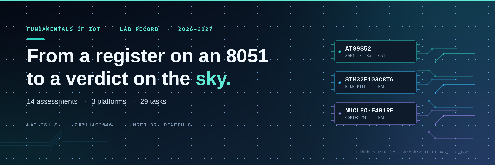

<p align="center">
  
</p>

# 25011102046_FIoT_LAB

A compilation of Internet of Things lab tasks performed during 2026-2027 by Kailesh S under the guidance of Dr. Dinesh G.
Hope it helps the needy :)

**14 assessments · 3 platforms · 29 tasks** — 8051 (AT89S52) · STM32F103C8T6 Blue Pill · NUCLEO-F401RE

---

## Read this first

This repository is not a zip file of answers. It is a record of fourteen assessments across three
microcontroller platforms, written up so that someone starting from zero can follow the same path.
Seven days of work went into it. Please use it with that much care.

**1. Start with `STM32/CAT15/` — that is SkyVerdict.**
It is the capstone of this lab and the best single example of what the course builds towards. Open
[`STM32/CAT15/SkyVerdict_Project.html`](STM32/CAT15/SkyVerdict_Project.html) in a browser — it is a
self-contained page that walks through the whole project: the idea, the hardware chain, the firmware
stages, the Node-RED flows, the measured results and the four bugs that taught the most. Everything
else in this repository is a stepping stone to that.


**2. Read the code with the README beside it — do not paste it blind.**
Every folder pairs a `README.md` with the C sources it describes. The README explains the intent, the
pin map and the logic; the `.c` file shows how it was actually done. Read them together. If you are in
a hurry, run the code through an assistant to grasp the essence — but understand what each function is
doing before you carry it anywhere. Copying code you do not understand is the worst thing you can do to
this course, and to yourself,and **to the REPO OWNER : ME :<> because it will be visible the moment someone asks you a question.**


**3. Do not open a `.uvproj` / `.uvprojx` file and start building.**
Those project files encode one person's toolchain paths, device selection and include directories. If
you open them and press Build, you will learn nothing about Keil — you will only learn how to press a
button that happens to work on someone else's machine. Take the `.c` and `.h` files, create a fresh
Keil project yourself, pick the device, add the sources, set the clock and the output options. That
half hour is the actual lesson. The same applies to the `.ioc` files for STM32: they are here as
documentation of the configuration, not as a shortcut to skip STM32CubeMX.


**4. Treat the folder names as the syllabus order.**
`CAT2` through `CAT7` are the 8051 arc: board bring-up, timers, HMI, interrupts, serial, display.
`CAT8` through `CAT15` are the STM32 arc: GPIO, UART, Wi-Fi modems, HTTP, sensors, MQTT, and finally a
complete IoT system. Each one assumes the previous one worked.

**5. The reason this is public: sharing enthusiasm for embedded systems.**
Nothing here is proprietary and nothing is polished for its own sake — it is a lab notebook that
happens to be readable. If it saves you a night of debugging, it did its job. Now go build something.

---

## What is in here, at a glance

| | |
|---|---|
| **Assessments** | 14 continuous assessments (CAT2 – CAT15) |
| **Individual tasks** | 29 |
| **Platforms** | 8051 · STM32F103C8T6 Blue Pill · NUCLEO-F401RE |
| **8051 board** | AMOTECH LABS 8051 development board, AT89S52, programmed over USBasp |
| **Toolchains** | Keil µVision (C51 for 8051, MDK-ARM + HAL for STM32), STM32CubeMX, PuTTY, Node-RED |
| **Sensors and modules** | BME280 (I²C), 16×2 LCD, 4×4 matrix keypad, seven-segment display, stepper motor, Wemos D1 Mini (ESP8266) |
| **Networking** | AT commands over UART, TCP and HTTP servers on the ESP8266, MQTT, Node-RED dashboards, OpenWeather API |

---

## Repository structure

```text
25011102046_FIoT_LAB/
│
├── 8051/                          AT89S52 · AMOTECH LABS board · Keil µVision C51
│   ├── CAT2/                      Board bring-up · SFR-based LED blink
│   ├── CAT3/                      Timer-based LED patterns · button interrupt
│   ├── CAT4/                      Matrix keypad · LEDs · seven-segment HMI
│   ├── CAT5/                      Timer 0 interrupts · software PWM · stepper motor
│   ├── CAT6/                      UART driver · serial debugging
│   └── CAT7/                      16×2 LCD driver · cursor control · keypad input
│
└── STM32/                         STM32F103C8T6 Blue Pill · NUCLEO-F401RE · Keil MDK + HAL
    ├── CAT8/                      GPIO bring-up · debouncing · short vs long press
    ├── CAT9/                      UART command-controlled LED
    ├── CAT10/                     STM32 ↔ Wemos ESP8266 AT command interface
    ├── CAT11/                     ESP8266 TCP server · HTTP server · Node-RED as second client
    ├── CAT12/                     Nucleo GPIO · onboard LED LD2 and user button B1
    ├── CAT13/                     BME280 over I²C · Bosch Sensor API
    ├── CAT14/                     BME280 + MQTT over a custom-built ESP8266 API
    └── CAT15/                     SkyVerdict — desk weather station vs the OpenWeather API
```

Each assessment folder holds its own `README.md`, its circuit diagram, and the firmware for each task.
Where an assessment has several tasks, the tasks sit in their own sub-folders (`TASK_A`, `TASK_B`, …).

---

## The 8051 arc — CAT2 to CAT7

Hardware: **AT89S52** on the **AMOTECH LABS** 8051 development board with its crystal oscillator and
5 V logic, programmed over the board's 10-pin ISP header with a **USBasp**. The onboard user LED sits on
**P1.0** and is active LOW. Toolchain: **Keil µVision with C51**.

| CAT | Experiment | Tasks | Date |
| :-- | :--- | :--- | :--- |
| **CAT2** | 8051 Development Board Bring-Up | 2A hardware identification and bring-up · 2B SFR-based LED blink | 20/07/2026 |
| **CAT3** | Timer-Based LED Pattern Generator and Button Interrupt Controller | 3 four-state LED control system | 27/07/2026 |
| **CAT4** | Human-Machine Interface using Matrix Keypad, LEDs and Seven-Segment Display | 4 keypad-driven display | 03/08/2026 |
| **CAT5** | Hardware Timer and Interrupt-Based Timing for LED Fading, Pulse Generation and Stepper Motor Control | 5A Timer 0 periodic interrupt · 5B software PWM in five variants · 5C stepper speed and direction | 10/08/2026 |
| **CAT6** | UART Driver and Serial Debugging | 6A UART initialisation and transmission · 6B UART echo | 17/08/2026 |
| **CAT7** | 16×2 LCD Driver Development and Dynamic Display Control | 7A initialisation and character display · 7B cursor positioning and dynamic values · 7C 4×4 keypad character movement | 24/08/2026 |

What this arc teaches, in order: how a register-level GPIO write actually reaches a pin (`sbit LED = P1^0;`
compiles to a bit-addressable SFR instruction), how hardware timers replace software `delay()` loops,
how a matrix keypad is scanned without blocking, how a UART frame is assembled and how to debug it on a
terminal, and how an HD44780-compatible LCD is initialised by hand — the four-bit sequence, the busy
flag, the DDRAM addressing. Everything after this is the same ideas at higher speed.

---

## The STM32 arc — CAT8 to CAT15

Two boards appear here, and it matters which one a folder targets.

- **STM32F103C8T6 Blue Pill** — CAT8, CAT9, CAT10, CAT11, CAT14. Onboard LED on **PC13**. Programmed over ST-Link.
- **NUCLEO-F401RE** — CAT12, CAT13, CAT15. Onboard LED **LD2 on PA5**, user button **B1 on PC13**. ST-Link is built into the board.

Toolchain for both: **STM32CubeMX** for pin and clock configuration, **Keil MDK-ARM** with the **HAL** libraries for the firmware.

| CAT | Board | Experiment | Tasks | Date |
| :-- | :--- | :--- | :--- | :--- |
| **CAT8** | Blue Pill | STM32 GPIO Bring-Up and Switch-Controlled LED | 8A GPIO input/output · 8B event-based control with switch debouncing · 8C short press vs long press classification | 18/09/2026 |
| **CAT9** | Blue Pill | STM32 UART Command Controlled LED | 9A basic UART communication · 9B string-based application logic | 28/09/2026 |
| **CAT10** | Blue Pill | STM32–Wemos Wi-Fi Modem Interface Using AT Commands | 10A STM32 ↔ Wemos UART link · 10B exploring the AT command interface · 10C configuring the ESP8266 as a Wi-Fi station | 05/10/2026 |
| **CAT11** | Blue Pill | HTTP Server — STM32–Wemos Wi-Fi Modem Using AT Commands | 11A configure ESP8266 as a TCP server · 11B observe an HTTP request and send a static response · 11C Node-RED as a second HTTP client | not recorded |
| **CAT12** | Nucleo | STM32F401: GPIO and User Input Programming | 12A onboard LED bring-up · 12B switch control with state remembrance · 12C short-press and long-press detection | not recorded |
| **CAT13** | Nucleo | BME280 Sensor Interfacing Using I²C and the Bosch Sensor API | 13 sensor readout over I²C, debug on UART, HTTP path via ESP8266 | to be updated |
| **CAT14** | Blue Pill | BME280 Sensor Interfacing Using I²C and MQTT Using a Custom-Built ESP8266 API | 14 environmental sensing over I²C, published over MQTT | 27/10/2026 |
| **CAT15** | Nucleo | SkyVerdict — a desk-level BME280 weather station that checks its own readings against the OpenWeather API in Node-RED | 15 complete system | 12/11/2026 |

Three things this arc makes obvious, and they are the reason it is ordered this way. First, **HAL is a
contract**: `HAL_GPIO_WritePin()` is doing exactly what `P1^0 = 1` did on the 8051, with a few layers of
indirection that exist so the same code runs on any STM32. Second, **a microcontroller has no idea what
the internet is** — CAT10 onwards exist to show that a Wi-Fi link is an external part with a serial
protocol of its own. Third, **an HTTP response is just bytes you write yourself** — by CAT11 the board is
serving one, by hand, with no network stack at all.

---

## The capstone — SkyVerdict (CAT15)

> A weather station that does not just read the sky. It argues with it.

📄 **[Read the full project walkthrough →](STM32/CAT15/SkyVerdict_Project.html)**
📁 Source: [`STM32/CAT15/`](STM32/CAT15/) · README: [`STM32/CAT15/README.md`](STM32/CAT15/README.md) · Flow diagram: [`skyverdict_flow.png`](STM32/CAT15/skyverdict_flow.png)

**The question it asks.** Most student weather projects stop at printing a number, which a ₹500 gadget
also does. SkyVerdict asks a harder one: when two independent measurements of the same sky disagree,
which should you trust, and what does the difference actually mean? The answer turns out to be
different for each quantity — and that is the whole point.

**The chain, in five hops.** Each hop exists because the previous one cannot do the next job.

| Hop | Device | Job | Why it cannot be skipped |
| :-- | :--- | :--- | :--- |
| 1 · sense | BME280 on I²C1 | Temperature, humidity, pressure | Measures well, communicates badly |
| 2 · think | STM32F401RE | Reads the sensor, builds the JSON, serves it | Has no idea what the internet is |
| 3 · speak | Wemos D1 Mini (ESP8266) | Wi-Fi link and TCP socket | Turns bytes into packets |
| 4 · listen | Node-RED on the laptop | Polls the board, parses JSON, drives the dashboard | Turns packets into information |
| 5 · decide | Verdict + Insight nodes | Compares both sources, ranks four morning activities | Turns information into a decision |

**The JSON contract** — the entire interface between firmware and dashboard, served in 221 bytes:

```json
{
  "status": "success",
  "temperature": 29.69,
  "humidity": 74.93,
  "pressure": 1008.35
}
```

The board writes that HTTP reply by hand over the ESP8266's TCP socket, and the console prints one line
per request — which is where the **33 ms** sensor-to-browser figure comes from. An interrupt-driven
1024-byte ring buffer on USART1 is what makes it possible: a browser sends 400–600 bytes of headers in
one burst, and the first version that polled byte-by-byte silently lost most of them.

**The result that makes it worth reading.** Two sources, one dashboard, and a verdict that refuses to
call a correct difference an error:

| Quantity | BME280 | OpenWeather | Δ | Verdict |
| :--- | ---: | ---: | ---: | :--- |
| Pressure (hPa, reduced to MSL) | 1012.03 | 1012.00 | 0.03 | **AGREES** |
| Temperature (°C) | 29.94 | 24.85 | 5.09 | expected offset |
| Humidity (%RH) | 73.96 | 92.00 | −18.04 | expected offset |

Pressure is the same measurand once both are reduced to sea level, so a 0.03 hPa agreement is real and
the tolerance is tight (0.05 %). Temperature and humidity are *not* the same measurand — the API reports
air at two metres over open ground, the sensor measures air beside a warm circuit board — so a five
degree gap is the correct answer to a different question, not a fault. The Insight node then converts
all of it into four activities scored out of 100 from the dew-point spread.

**Four failures, which taught more than the working version.**

1. **Bytes were vanishing** — echoing each received byte before reading the next overran the receive
   register. Fixed with an interrupt-driven ring buffer: minutes down to 33 ms.
2. **The sensor lied convincingly** — 0.30 °C and 0.07 %RH looked like a dead sensor. It was a unit
   mismatch in the Bosch driver; pressure survived the bug because it genuinely needed dividing by 100,
   which is exactly why it was the clue.
3. **The radio forgot its job** — the ESP8266 keeps Wi-Fi credentials across a reset but not
   `CIPSERVER`, so a power blip left a board that answered pings and refused every request. The setup
   sequence is now re-issued on every boot.
4. **Two dashboards, one port** — two Node-RED dashboard packages fighting over one socket made the
   whole page refuse to render, which looked like broken code and was not.

**None of these were solved by reading documentation. All of them were solved by measuring something and
being surprised by the answer.**

---


- **Build the project yourself.** Copy the sources, not the `.uvproj`. Pick the device in Keil, add the
  files, set the target options, build. For STM32, create the project in CubeMX from the pin map in the
  README rather than importing the `.ioc`, so you learn what each peripheral setting does.
- **Pin maps are in the READMEs, not in your head.** Every folder states which pin drives what. Check it
  against your own wiring before you power the board — a 5 V signal into an ESP8266 RX pin will end the
  evening early.
- **Common ground, always.** Every module on every board in this repository shares a ground with the
  microcontroller. It is the single most common reason a circuit "does not work".
- **The ESP8266 is 3.3 V and it is hungry.** Do not power a Wemos D1 Mini from the board's 3.3 V pin —
  Wi-Fi transmit bursts draw far more than that pin can supply. Use its own USB cable.
- **Record the date and the inference on the day.** Both are unrecoverable later, and both are what the
  record is actually for.
- **if required - Keep build output out of git.** A `.gitignore` for Keil projects:


## Credits :]

Written up by **Kailesh S** (25011102046) for the Fundamentals of IoT laboratory, 2026-2027, under
**Dr. Dinesh G.**

The README format, the folder discipline and the assessment structure follow the department's sample
repository. The firmware, the wiring, the debugging and every inference in these folders came from
sitting with the board until it worked.

## If this repository helped you, the best thing you can do in return is understand it properly and then
## build something of your own.
