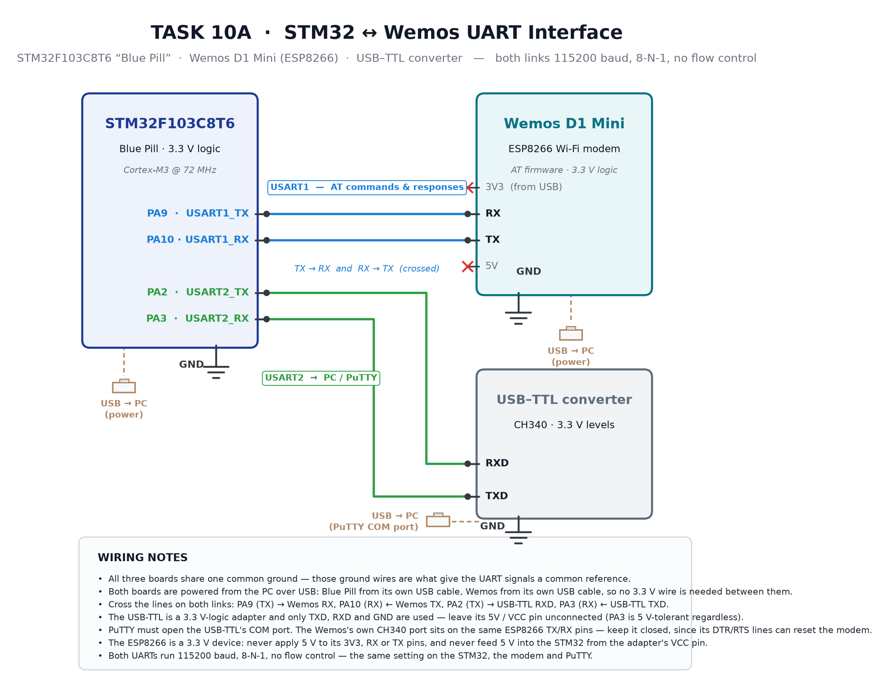

# EXPERIMENT DETAILS

**EXP:** CONTINUOUS ASSESSMENT 10

**DATE:** 05/10/2026

**NAME OF EXP:** STM32–Wemos Wi-Fi Modem Interface Using AT Commands

**HARDWARE SETUP / PLATFORM:** STM32 development board programmed with STM32CubeMX and Keil MDK using the STM32 HAL libraries, with a Wemos D1 Mini (ESP8266) acting as the Wi-Fi modem over USART1 and a PC terminal (PuTTY) on USART2 at 115200 baud, 8 data bits, no parity, 1 stop bit.

---

## TASK 1 : STM32 ↔ Wemos UART Communication (Task 9A)

### 1. Circuit Diagram

Before any Wi-Fi work, the experiment has to prove that the two boards can talk to each other. The Wemos D1 Mini is not driven as a programmable board here — it is used as a modem, so its TX and RX lines are cross-connected to the STM32's USART1 and every byte that crosses the link is visible on the PC terminal. The STM32 is the only master on the link: it sends an AT command, waits for the reply, and mirrors both directions to USART2 so the operator can watch the dialogue. A second UART is used for the PC precisely so that the modem traffic and the human-readable display never share one peripheral — this is the two-UART arrangement the lab sheet recommends.

- **Development Board:** STM32 development board
- **Wi-Fi Modem:** Wemos D1 Mini (ESP8266), running its factory AT firmware
- **GPIO Pins:** PA2 (USART1_TX) → Wemos RX, PA3 (USART1_RX) ← Wemos TX
- **Second Peripheral:** USART2 → PC through the on-board USB virtual COM port, for the PuTTY / Tera Term display
- **Power Supply:** 3.3 V and GND from the STM32 board to the Wemos, with a common ground reference between the two boards
- **Baud Rate:** 115200, 8-N-1, no hardware flow control, on both UARTs

| Wemos D1 Mini pin | STM32 pin | Description |
| --- | --- | --- |
| TX | PA3 (USART1_RX) | Data from Wemos to STM32 |
| RX | PA2 (USART1_TX) | Data from STM32 to Wemos |
| GND | GND | Common ground reference |
| 3V3 | 3V3 | Power supply for the modem |

| UART | Connection | Purpose |
| --- | --- | --- |
| USART1 | STM32 ↔ Wemos | AT commands and responses |
| USART2 | STM32 ↔ PC | Debug / display |



### 2. Core Logic / Pseudocode / Code Base

**Working Principle:**

The link is built so that nothing ever blocks while waiting for the modem. USART1 is armed in interrupt mode one byte at a time; every byte the Wemos sends is caught in the receive-complete callback and pushed into a ring buffer, and the main loop drains that buffer at its own pace. Because the interrupt only moves one byte and returns, a long reply such as a network scan cannot be missed even though the program is busy printing to the PC.

The PC side is deliberately handled differently. USART2 is polled with a 1 ms timeout, which keeps a single place in the code where a typed character is echoed, edited and assembled into a command line. When the operator presses Enter, the finished line is written to USART1 followed by `\r\n`, which is exactly the terminator the AT parser in the modem expects. A flag absorbs the second half of the CRLF pair so that one Enter never fires two commands, and backspace removes a character from the buffer while emitting `\b \b` so the terminal display stays in step with what will actually be sent.

**Ring buffer sizing — why 2048 bytes:**

At 115200 baud with 8-N-1 framing, each byte occupies ten bit-times, so the link carries

$$R = \frac{115200}{10} = 11520\ \text{bytes/s}$$

A 2048-byte buffer therefore holds

$$t = \frac{2048}{11520} \approx 178\ \text{ms}$$

of continuous modem traffic. That is far more than any single AT reply in this experiment, so the main loop always catches up before the buffer can wrap. The buffer keeps one slot free to distinguish full from empty, so the usable capacity is 2047 bytes; if the head ever meets the tail, the callback sets `rxOverflow` and the main loop prints a single warning line instead of losing data silently.

**Pseudocode:**

```
/* globals : rxBuffer[2048], rxHead ← 0, rxTail ← 0, rxOverflow ← 0 */

USART1_RX_ISR()                    // one byte has arrived from the Wemos
1   next ← (rxHead + 1) mod 2048
2   if next ≠ rxTail then
3       rxBuffer[rxHead] ← byte   // room available, store it
4       rxHead ← next
5   else
6       rxOverflow ← 1            // buffer full, report to the main loop
7   end if
8   re-arm the one-byte interrupt receive on USART1
9   return

MAIN()
1   initialise clock, GPIO, USART1 (Wemos) and USART2 (PC) at 115200 8-N-1
2   print the banner on USART2
3   arm the USART1 interrupt receive
4   while TRUE do
5       while rxTail ≠ rxHead do          // drain modem traffic
6           ProcessWemosByte(rxBuffer[rxTail])
7           rxTail ← (rxTail + 1) mod 2048
8       end while
9       if a PC byte arrives within 1 ms then
10          echo it back to the PC
11          if byte is CR or LF then
12              send the assembled command to USART1, then CR LF
13              clear the command buffer
14          else if byte is BS or DEL then
15              remove the last character and erase it on screen
16          else
17              append the character to the command buffer (max 128)
18          end if
19      end if
20      if rxOverflow then print "Wemos UART buffer overflow" ; rxOverflow ← 0
21  end while
```

**Code Base:**

The program is one `main.c` built with the STM32 HAL on top of CubeMX-generated initialisation. The clock, GPIO and both UART initialisers are kept as generated, with two portable clock branches (`RCC_PLLP_DIV2` for the F4-class parts and `RCC_PLL_MUL16` for the F1-class parts) so the same file builds on either board. `HAL_UART_Receive_IT` and `HAL_UART_RxCpltCallback` carry the receive path, `HAL_UART_Transmit` carries the send path, and `HAL_UART_Receive` with a 1 ms timeout carries the PC side. Every blocking transmit uses an explicit timeout (1000 ms for commands, 3000 ms for the HTTP body) and falls through to `Error_Handler()` on failure rather than hanging forever.

**UART configuration, register by register (CubeMX / Keil MDK):**

- **`huart1.Instance = USART1;` — choosing the peripheral.** USART1 is the one wired to the Wemos, so it owns the AT dialogue. USART2 is left to the PC display, which is why two handles (`huart1`, `huart2`) exist and why the receive callback checks `huart->Instance == USART1` before touching the ring buffer.

- **`huart1.Init.BaudRate = 115200;` — matching the modem.** The ESP8266 AT firmware defaults to 115200, so both sides must be set to the same rate or the reply arrives as framing garbage. The clock tree is configured first (`SystemClock_Config`) because the baud rate divisor is derived from the peripheral clock; a wrong clock gives a wrong baud even when the register says 115200.

- **`WordLength = UART_WORDLENGTH_8B; StopBits = UART_STOPBITS_1; Parity = UART_PARITY_NONE;` — 8-N-1 framing.** AT commands are ASCII text, so eight data bits with no parity and one stop bit are enough, and this is the frame the modem expects.

- **`Mode = UART_MODE_TX_RX;` — both directions enabled.** The link is bidirectional: commands go out on TX and replies come back on RX. Disabling either direction would break the bridge.

- **`HwFlowCtl = UART_HWCONTROL_NONE;` — no RTS/CTS.** The Wemos D1 Mini does not expose hardware flow control pins in this wiring, so flow control is left off and overrun is prevented in software by the ring buffer.

- **`OverSampling = UART_OVERSAMPLING_16;` — the standard sampling mode.** Sixteen samples per bit give the usual noise tolerance and the divisor the baud-rate maths assumes.

### 3. Inference

Typing `AT` in the terminal and receiving `OK` proves the physical link, the framing and the firmware path in one shot:

```
>> AT
<< OK
```

The command reached the modem, the modem answered, the STM32 caught the reply in its interrupt and mirrored it to the PC, and nothing was lost or duplicated across the two UARTs. This satisfies the sheet's precondition for Task 9A — the two boards demonstrably communicate — and it is the platform every later task is built on.

---
