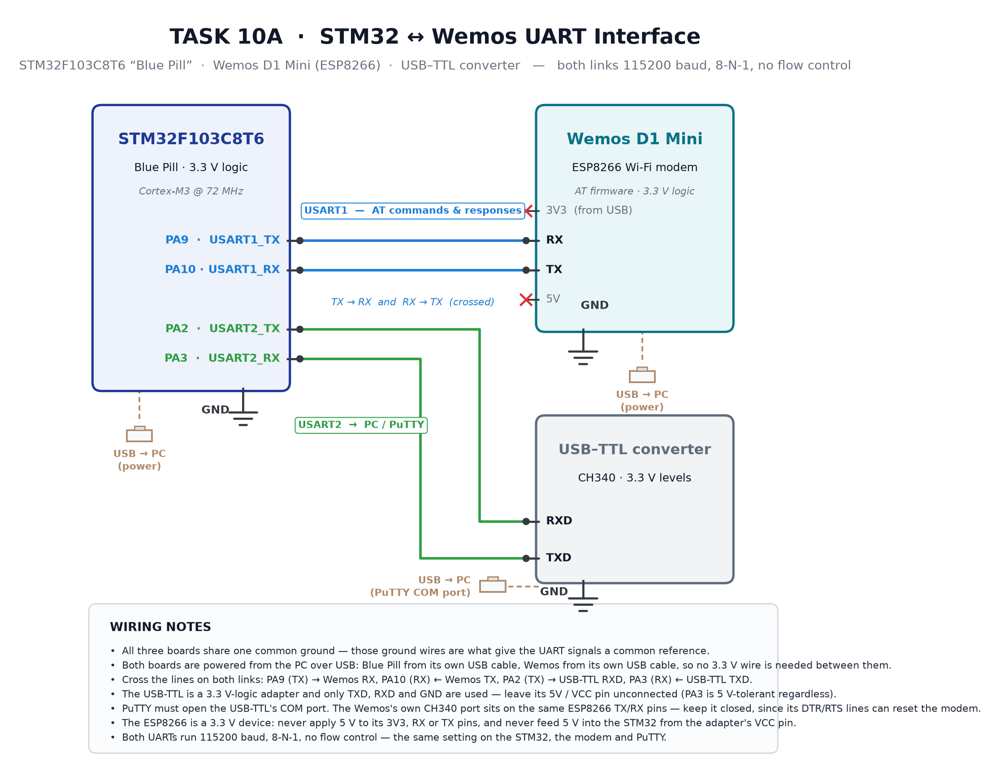

# EXPERIMENT DETAILS

**EXP:** CONTINUOUS ASSESMENT 10

**DATE:** 05/10/2026

**NAME OF EXP:** STM32–Wemos Wi-Fi Modem Interface Using AT Commands

**HARDWARE SETUP / PLATFORM:** STM32F103C8T6 "Blue Pill" with a Wemos D1 Mini (ESP8266) on USART1 and a CH340 USB–TTL converter on USART2 feeding a PuTTY terminal at 115200 baud, 8-N-1, no flow control. Both boards are powered from their own USB cables.

---

## TASK 10B : Explore the ESP8266 AT Command Interface

The modem is driven entirely by text commands. A command is typed at the PuTTY prompt, the STM32 forwards it to the Wemos over USART1 with a `\r\n` terminator, and every byte the modem answers is echoed back to the terminal, so what appears on screen is the ESP8266's own reply. Nothing is programmed for this task — the table below is the deliverable, and each row is verified by the output shown next to it.



*Figure 1 — Wiring is the same as Task 10A: USART1 (PA9/PA10) carries the AT dialogue, USART2 (PA2/PA3) carries it to PuTTY through the USB–TTL converter. Only the commands change.*

### Command summary

| Requirement | Command | Expected reply |
| --- | --- | --- |
| Check modem response | `AT` | `OK` |
| Check firmware / version | `AT+GMR` | version lines, then `OK` |
| Set Wi-Fi station mode | `AT+CWMODE=1` | `OK` |
| Scan available networks | `AT+CWLAP` | `+CWLAP:(...)` per access point, then `OK` |
| Connect to an AP | `AT+CWJAP="SSID","password"` | `WIFI CONNECTED`, `WIFI GOT IP`, `OK` |
| Obtain network information | `AT+CIFSR` | `+CIFSR:STAIP,...`, `+CIFSR:STAMAC,...`, `OK` |
| Enable multiple connections | `AT+CIPMUX=1` | `OK` |
| Establish TCP connection | `AT+CIPSTART=0,"TCP","host",port` | `0,CONNECT`, `OK` |
| Send application data | `AT+CIPSEND=0,<len>` | `>` prompt, then `SEND OK` |
| Close the connection | `AT+CIPCLOSE=0` | `0,CLOSED`, `OK` |

---

### 1. `AT` — check that the modem is alive

The simplest possible command: it asks the modem to acknowledge itself. If the reply is `OK`, the baud rate, the wiring and the modem's firmware are all correct, so this is always the first command typed.

```
>> AT
<< OK
```

### 2. `AT+GMR` — read the firmware version

Returns the AT firmware version, the SDK version, the compile time and the binary variant. It is useful evidence because it proves which command set the modem actually supports; the syntax of the TCP commands differs between firmware versions.

```
>> AT+GMR
<< AT version:1.7.4.0(May 11 2020 19:13:04)
<< SDK version:3.0.4(9532ceb)
<< compile time:May 27 2020 10:12:17
<< Bin version(Wroom 02):1.7.4
<< OK
```

### 3. `AT+CWMODE=1` — put the modem into station mode

The ESP8266 can act as a station (a client joining an access point), as a soft access point, or as both. `1` selects station mode, which is the only mode in which it can join a network. `AT+CWMODE?` reads the current setting back.

```
>> AT+CWMODE=1
<< OK
>> AT+CWMODE?
<< +CWMODE:1
<< OK
```

### 4. `AT+CWLAP` — scan for networks in range

Lists every access point the modem can hear. Each line is `+CWLAP:(<encryption>,<ssid>,<rssi>,<mac>,<channel>,<frequency offset>)`, where the encryption code runs from 0 (open) to 4 (WPA/WPA2), and the RSSI is in dBm — a value closer to zero means a stronger signal. This is the reply that proves the receive path can carry a long, multi-line response.

```
>> AT+CWLAP
<< +CWLAP:(3,"MyWiFi",-45,"aa:bb:cc:dd:ee:ff",6,-1)
<< +CWLAP:(4,"Lab_AP",-67,"11:22:33:44:55:66",11,-1)
<< +CWLAP:(0,"OpenNet",-82,"22:33:44:55:66:77",1,-1)
<< OK
```

### 5. `AT+CWJAP="SSID","password"` — join an access point

Sends the credentials and waits. The modem reports progress in stages: `WIFI CONNECTED` when the radio associates, `WIFI GOT IP` when DHCP has handed out an address, and finally `OK`. If the password is wrong the reply is `+CWJAP:1` with `FAIL`, and the modem may report `WIFI DISCONNECT` first.

```
>> AT+CWJAP="MyWiFi","password"
<< WIFI DISCONNECT
<< WIFI CONNECTED
<< WIFI GOT IP
<< OK
```

### 6. `AT+CIFSR` — read the address the network gave us

Returns the station IP and the station MAC address. This address is what a browser or another device on the same network would use to reach the board, so it is the number to note down for the data-transfer step.

```
>> AT+CIFSR
<< +CIFSR:STAIP,"192.168.1.42"
<< +CIFSR:STAMAC,"aa:bb:cc:dd:ee:ff"
<< OK
```

### 7. `AT+CIPMUX=1` — allow numbered links

Enables multiple connections, which is what makes the modem report incoming data as `+IPD,<link>,<length>:`. In single-connection mode the same message arrives as `+IPD,<length>:` with no link number, and the send command takes no link argument. The firmware used here answers with the numbered form, so this command comes before opening the socket.

```
>> AT+CIPMUX=1
<< OK
```

### 8. `AT+CIPSTART=0,"TCP","host",port` — open a TCP socket

Starts a TCP connection on link 0 to the given host and port. The reply `0,CONNECT` means the socket is open, and `OK` confirms the command was accepted. A refused connection comes back as `0,CLOSED` or `ERROR`, depending on the firmware.

```
>> AT+CIPSTART=0,"TCP","192.168.1.10",8080
<< 0,CONNECT
<< OK
```

### 9. `AT+CIPSEND=0,<len>` — send data on that socket

Declares how many bytes are about to be written. The modem answers with a `>` prompt and only then switches to raw data mode, so the payload is sent after the prompt appears and not before. On success the modem reports `SEND OK`; a failed transfer reports `SEND FAIL`.

```
>> AT+CIPSEND=0,45
<< >
   (45 bytes of the payload are sent here)
<< SEND OK
```

Data arriving from the network is announced on the same link in the form `+IPD,0,<len>:` followed immediately by that many raw bytes:

```
<< +IPD,0,120
   (120 bytes of the incoming request)
```

### 10. `AT+CIPCLOSE=0` — close the link

Frees the socket. Closing after each exchange keeps the connection count at one and makes the next request arrive as a fresh `+IPD` rather than in the middle of a transfer.

```
>> AT+CIPCLOSE=0
<< 0,CLOSED
<< OK
```

---

## Full terminal session (in order)

The sequence below is the complete run: link check, firmware, station mode, scan, join, address, then a socket opened and closed.

```
>> AT
<< OK
>> AT+GMR
<< AT version:1.7.4.0(May 11 2020 19:13:04)
<< SDK version:3.0.4(9532ceb)
<< OK
>> AT+CWMODE=1
<< OK
>> AT+CWLAP
<< +CWLAP:(3,"MyWiFi",-45,"aa:bb:cc:dd:ee:ff",6,-1)
<< +CWLAP:(4,"Lab_AP",-67,"11:22:33:44:55:66",11,-1)
<< OK
>> AT+CWJAP="MyWiFi","password"
<< WIFI CONNECTED
<< WIFI GOT IP
<< OK
>> AT+CIFSR
<< +CIFSR:STAIP,"192.168.1.42"
<< +CIFSR:STAMAC,"aa:bb:cc:dd:ee:ff"
<< OK
>> AT+CIPMUX=1
<< OK
>> AT+CIPSTART=0,"TCP","192.168.1.10",8080
<< 0,CONNECT
<< OK
>> AT+CIPSEND=0,45
<< >
<< SEND OK
>> AT+CIPCLOSE=0
<< 0,CLOSED
<< OK
```

## If the reply is not what is expected

- **Nothing at all, or readable-looking garbage.** The baud rate does not match — both links run 115200, 8-N-1, and the terminal must be set the same way.
- **`ERROR` after a command.** The syntax is wrong for this firmware version; check `AT+GMR` and the quoting of the SSID and password (both take double quotes).
- **`FAIL` after `AT+CWJAP`.** Wrong password, or the modem cannot hear that network — confirm the SSID from the `AT+CWLAP` list.
- **`+IPD,<len>:` with no link number.** The modem is still in single-connection mode; `AT+CIPMUX=1` has not been applied.
- **`busy p...`.** A previous command is still in progress; wait for `OK` before typing the next one.

**ATTENTION FOR TEH VIEWERS : THE COMMANDS REPLIES ARE NOT WHAT YOU WILL GET EXACTLY , ITS JUST AN OVERLOOK OF EXPECTED ANSWERES FROM TEH AT FIRMWARE PRESENT IN THE WEMOS D1 MINI , FOR EXACT RESPONSES VISIT espressif and their documentations, TQ:)**
