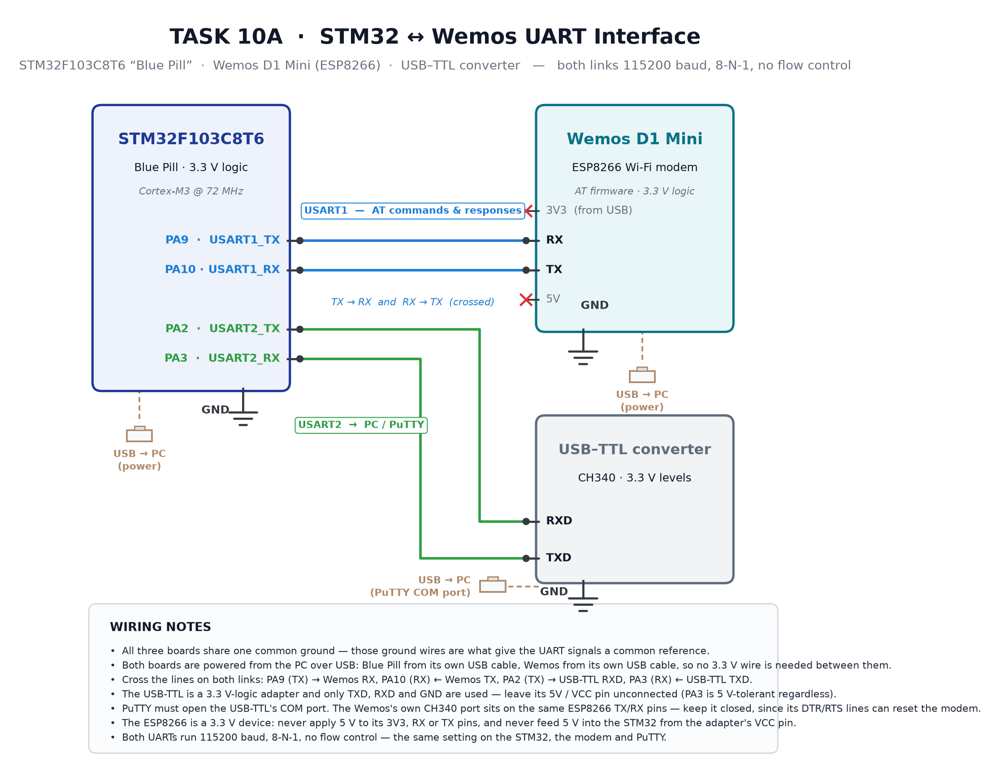

# EXPERIMENT DETAILS

**EXP:** CONTINUOUS ASSESMENT 10

**DATE:** 05/10/2026

**NAME OF EXP:** STM32–Wemos Wi-Fi Modem Interface Using AT Commands — Configuring the ESP8266 as a Wi-Fi Station

**HARDWARE SETUP / PLATFORM:** STM32F103C8T6 "Blue Pill" running at 72 MHz (8 MHz HSE crystal + PLL ×9), configured in STM32CubeMX and compiled in Keil MDK with the STM32 HAL libraries. Wemos D1 Mini (ESP8266) on USART1 and a CH340 USB–TTL converter on USART2 driving a PuTTY terminal at 115200 baud, 8-N-1. Both boards are powered from their own USB cables.

---

## TASK 10C : Configure the Wemos ESP8266 as a Wi-Fi Station

### 1. Circuit Diagram

The wiring is the same two-bus arrangement used for the earlier tasks, and nothing about it changes for this one: the modem keeps USART1 to itself, and the PC keeps USART2, so the Wi-Fi dialogue and the terminal display never share a peripheral. What changes is what is sent across the link — instead of a single `AT`, the firmware now sends a fixed four-command sequence that puts the modem into station mode, hands it the credentials, and reads back the address the network assigned.

Both boards take power from their own USB cables, so no 3.3 V wire runs between them; only the two signal lines and a common ground are shared. That ground is what gives the UART levels a common reference, and it is the only thing the two boards must agree on electrically.



*Figure 1 — Task 10C uses the Task 10A wiring unchanged: USART1 (PA9/PA10) carries the AT commands and replies to the Wemos, USART2 (PA2/PA3) forwards them to PuTTY through the USB–TTL converter, and all three grounds are common.*

- **Development Board:** STM32F103C8T6 "Blue Pill" (Cortex-M3, 72 MHz, 3.3 V logic), powered from its own USB cable
- **Wi-Fi Modem:** Wemos D1 Mini (ESP8266) with AT firmware, powered from its own USB cable
- **PC Interface:** CH340 USB–TTL converter (3.3 V logic) on USART2 — the COM port PuTTY opens
- **USART1 Pins:** PA9 (USART1_TX) → Wemos RX, PA10 (USART1_RX) ← Wemos TX
- **USART2 Pins:** PA2 (USART2_TX) → USB-TTL RXD, PA3 (USART2_RX) ← USB-TTL TXD
- **Network:** university / local access point, SSID `SNUC`, reachable by the ESP8266 on 2.4 GHz
- **Baud Rate:** 115200, 8-N-1, no hardware flow control, on both UARTs

| Wemos D1 Mini pin | STM32F103C8T6 pin | Description |
| --- | --- | --- |
| TX | PA10 (USART1_RX) | Replies and status messages to the STM32 |
| RX | PA9 (USART1_TX) | AT commands from the STM32 |
| GND | GND | Common ground reference |
| 3V3 | — (not connected) | Module is powered from its own USB cable |
| 5V | — (not connected) | Never used |

| USB–TTL pin | STM32F103C8T6 pin | Description |
| --- | --- | --- |
| RXD | PA2 (USART2_TX) | Terminal shows the modem's replies |
| TXD | PA3 (USART2_RX) | Not used in this task — the firmware types the commands itself |
| GND | GND | Common ground reference |
| VCC / 5V | — (not connected) | Only TXD, RXD and GND are used |

### 2. Core Logic / Pseudocode / Code Base

**Working Principle:**

The firmware is a fixed script rather than an interactive bridge. After the HAL, clock and UART initialisation it enters the main loop and walks through four commands in order, and for each one it does the same three things: transmit the command string on USART1, collect the reply byte by byte into a 500-byte buffer, and forward whatever it collected to USART2 so PuTTY shows the modem's own words. After the fourth command the program parks itself in a permanent delay loop, so the sequence runs exactly once per reset.

The interesting decision is how a reply is considered finished. Rather than counting bytes or waiting for a fixed delay, each receive call asks for **one byte with a timeout**, and the collection loop stops as soon as a byte fails to arrive inside that timeout. That makes the timeout itself the end-of-reply marker: the modem answers quickly, so a gap longer than the timeout means the message is complete. The timeouts are chosen per command because the commands differ in how long they take — 2 s is generous for `AT` and `AT+CWMODE=1`, but joining an access point involves a radio association and a DHCP exchange, so `AT+CWJAP` is given 15 s. `AT+CIFSR` gets 3 s.

**Command sequence:**

| Step | Command sent | Purpose | Timeout |
| --- | --- | --- | --- |
| 1 | `AT` | Confirm the modem is responding | 2000 ms |
| 2 | `AT+CWMODE=1` | Select station mode | 2000 ms |
| 3 | `AT+CWJAP="SNUC","snu12345"` | Join the access point | 15000 ms |
| 4 | `AT+CIFSR` | Read the assigned IP and MAC | 3000 ms |

**Pseudocode:**

```
MAIN()
1   initialise HAL, clock, GPIO, USART1 (Wemos) and USART2 (PC) at 115200 8-N-1
2   repeat
3       for each command in [ AT , AT+CWMODE=1 , AT+CWJAP="SSID","password" , AT+CIFSR ]
4           transmit the command on USART1
5           len ← 0
6           while len < 499 do
7               if one byte arrives on USART1 within this command's timeout then
8                   store it in response[len] ; len ← len + 1
9               else
10                  break                       // timeout means the reply has ended
11              end if
12          end while
13          if len > 0 then forward response[0..len-1] to USART2
14          wait 1 s (2 s after the join, so the modem can settle)
15      end for
16      park in a permanent 1 s delay loop
17  end repeat
```

**Code Base:**

The program is a single `main.c` on top of CubeMX-generated initialisation, with the four command strings declared as local arrays so they are sent as byte buffers of known length (`sizeof(cmd) - 1`, which excludes the terminating NUL while keeping the `\r\n`). `HAL_UART_Transmit` sends and `HAL_UART_Receive` collects; both use `HAL_MAX_DELAY` for the transmit side because a command string is a few bytes and always fits the shift register. A helper function `Send_AT_Command()` is also defined for exactly this send-and-collect job, but the four steps are written inline in `main()`, so the helper is present and unused — worth mentioning if the code is reviewed, since it is dead code rather than part of the running path.

**Configuration notes, one decision at a time:**

- **`AT+CWMODE=1` before `AT+CWJAP`** — the mode command comes first because in its default mode the modem does not behave as a station, and the join is either refused or ignored. The order is the requirement, not a preference.

- **`AT+CWJAP="SNUC","snu12345"` — quoted arguments.** Both the SSID and the password must be wrapped in double quotes in the command string itself, which is why they appear escaped as `\"` in the C array. An unquoted SSID is the usual cause of an `ERROR` reply here.

- **`response[500]` with a `len < sizeof(response) - 1` guard** — the buffer is left with one spare byte and the loop stops before it can overrun. The largest reply in this task is the join sequence, well under 100 bytes, so 500 is comfortable.

- **2000 / 15000 / 3000 ms timeouts** — these are end-of-reply detectors, not patience settings. Too short and a reply is cut in half; too long and the program wastes time waiting after every command. The join gets the largest value because association plus DHCP is the slowest step.

- **`HAL_Delay(2000)` after the join** — gives the modem time to finish its internal bookkeeping before `AT+CIFSR` asks for the address, so the reply is not read while the modem is still mid-connection.

- **72 MHz from `PLL_MUL9` on the 8 MHz HSE** — the UART baud divisors are derived from this clock, so a wrong PLL setting shows up as garbled text rather than an obvious fault.

### 3. Expected output on the terminal

Because the firmware forwards replies without any labels of its own, PuTTY shows the modem's replies back to back, one block per command:

```
OK

OK

WIFI DISCONNECT
WIFI CONNECTED
WIFI GOT IP

OK

+CIFSR:STAIP,"10.24.7.118"
+CIFSR:STAMAC,"aa:bb:cc:dd:ee:ff"

OK
```

Read top to bottom, the four blocks are the answers to the four commands: `OK` for `AT`, `OK` for `AT+CWMODE=1`, the three-line join report for `AT+CWJAP` (`WIFI CONNECTED` when the radio associates, `WIFI GOT IP` when DHCP completes, then `OK`), and the station IP and MAC for `AT+CIFSR`. The address shown in the last block is what any other device on the same network would use to reach the board.

The lab sheet asks for the modem state to be reported as three labelled lines. This firmware forwards the raw replies instead of re-formatting them, so the same information is read off those replies:

| Sheet's expected report | Where it appears in the terminal |
| --- | --- |
| `WIFI MODE : STATION` | `OK` from `AT+CWMODE=1` (and `+CWMODE:1` if `AT+CWMODE?` is used) |
| `WIFI STATUS : CONNECTED` | `WIFI CONNECTED` followed by `WIFI GOT IP` |
| `IP ADDRESS : xxx.xxx.xxx.xxx` | `+CIFSR:STAIP,"..."` |

If the password is wrong the join block reads `+CWJAP:1` with `FAIL` instead of `WIFI GOT IP`, and `AT+CIFSR` then returns `0.0.0.0` — which is the quickest way to tell a credential problem from a wiring problem.

### 4. Inference

The sequence proves the modem can be driven entirely from the STM32: it is put into station mode, handed credentials, associated with the access point, given an address by DHCP, and asked to report that address — all through AT commands sent by the firmware, with every reply visible on the PC. Because the mode is set before the join and the address is read only after `WIFI GOT IP`, the reply order in the terminal is itself the evidence that the sequence executed correctly.

Two details are worth knowing for the viva. The firmware does not parse the replies — it forwards them — so a successful join is judged by reading `WIFI GOT IP` on the terminal, not by any check in the code; adding a `strstr` on the buffer would turn that into a program decision. And the SSID and password are compiled into the source as string literals, which is fine for a lab bench but should be replaced with placeholders before the code is published anywhere public.

---

## EVIDENCE TO ATTACH

| File | What it shows |
| --- | --- |
| `circuit_sketch_10c.png` | Wiring diagram, unchanged from Task 10A (embedded above) |
| `at-ok.png` | Terminal showing `OK` for the initial `AT` and `AT+CWMODE=1` |
| `wifi-join.png` | `WIFI CONNECTED` / `WIFI GOT IP` block from `AT+CWJAP` |
| `cifsr-ip.png` | `+CIFSR:STAIP,"..."` block showing the assigned IP address |
