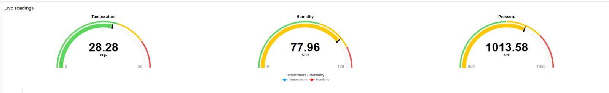

# CAT11C Node-RED Evidence

## Evidence files

| File | What it shows |
| --- | --- |
| `dashboard.jpeg` | The live dashboard output — the three BME280 gauges (Temperature 28.28 degC, Humidity 77.96 %RH, Pressure 1013.58 hPa) rendered by the Node-RED dashboard. |
| `node-flow.png` | The deployed Node-RED flow — the BME280 polling node, the "Split values" function node and its debug/dashboard outputs, plus the "raw JSON" debug node. |

## Dashboard — live readings

Screenshot of the dashboard page showing the current sensor readings from the deployed flow.

## Node flow — deployed Node-RED flow

Screenshot of the Node-RED editor showing the BME280 Dashboard flow as deployed.

