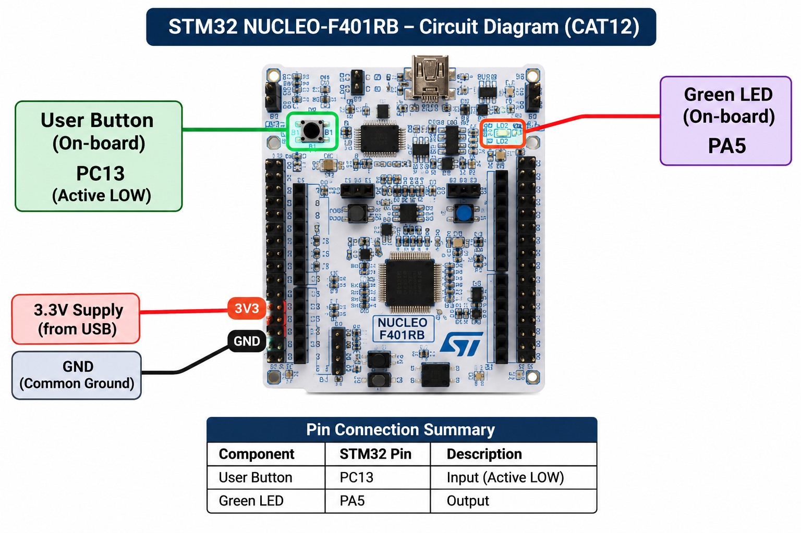

# CAT12 – GPIO and User Input Programming

## Experiment Overview

This CAT covers GPIO output control and user input programming using the STM32F401RB Cortex-M4 microcontroller. The experiments are implemented on the NUCLEO-F401RB development board using STM32CubeMX, Keil MDK-ARM and the STM32 Hardware Abstraction Layer (HAL).

## Required Documentation

| **Field** | **Description** |
|---|---|
| **EXP** | CAT12 |
| **DATE** | Not specified |
| **NAME OF EXP** | STM32F401RB Cortex-M4: GPIO and User Input Programming |
| **HARDWARE SETUP / PLATFORM** | NUCLEO-F401RB development board, STM32F401RB Cortex-M4 microcontroller, onboard LED LD2 (PA5) and USER pushbutton B1 (PC13), STM32CubeMX and Keil MDK-ARM IDE with STM32 HAL. |
| **TASK NO** | Tasks 1, 2 and 3 |

## Hardware Setup

The experiments use the onboard peripherals of the NUCLEO-F401RB development board.

| **Component** | **STM32 Pin** | **Purpose** |
|---|---|---|
| Onboard LED LD2 | PA5 | GPIO output for LED control |
| Onboard USER button B1 | PC13 | GPIO input for button detection |

No external LED, pushbutton or jumper-wire connections are required.

## Circuit Diagram

## Experiment Tasks

### Task 1 – On-board LED Bring-Up
Configure PA5 as a GPIO output and control the onboard LED using a programmed flashing sequence.

**Folder:** `TASK12_A/`

### Task 2 – On-board Switch Control with State Remembrance
Read the onboard USER button through PC13 and toggle the LED state on every valid button press, retaining the state after release.

**Folder:** `TASK12_B/`

### Task 3 – Short-Press and Long-Press Detection
Measure the duration of a button press and perform different LED actions depending on whether the press is shorter or longer than the implemented 1000 ms threshold.

**Folder:** `TASK12_C/`

## Development Environment

- **Microcontroller:** STM32F401RB Cortex-M4
- **Development Board:** NUCLEO-F401RB
- **Configuration Tool:** STM32CubeMX
- **IDE:** Keil MDK-ARM
- **Programming Interface:** STM32 HAL
- **Programming Language:** Embedded C

## Inference

The CAT12 experiments demonstrate the use of STM32 GPIO peripherals for output control and user input detection. The tasks progress from controlling an onboard LED to handling button presses, retaining output states, applying debouncing and distinguishing short and long presses based on elapsed time.