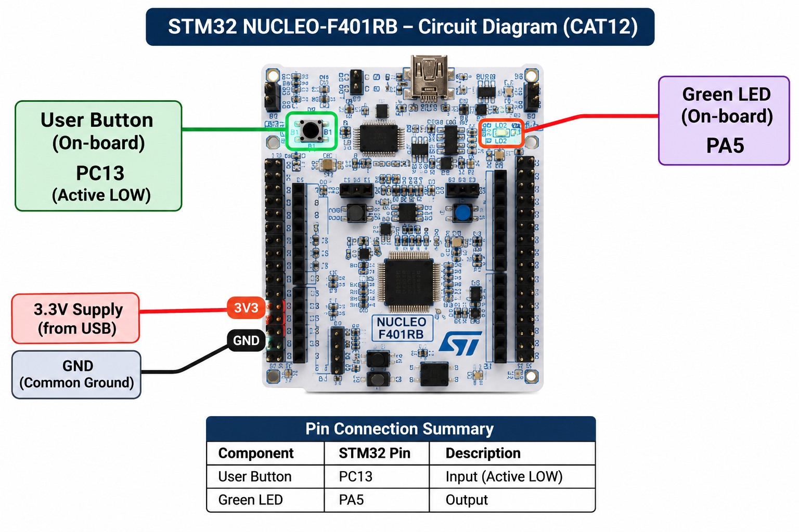

# TASK 12A – On-board LED Bring-Up

| **Field** | **Description** |
|---|---|
| **EXP** | CAT12 – Task 1 |
| **DATE** | Not specified |
| **NAME OF EXP** | On-board LED Bring-Up |
| **HARDWARE SETUP / PLATFORM** | NUCLEO-F401RB development board, STM32F401RB Cortex-M4 microcontroller, onboard user LED LD2 connected to PA5. STM32CubeMX and Keil MDK-ARM IDE with STM32 HAL. |
| **TASK NO** | Task 1 |

### Circuit Diagram

The onboard LED LD2 is internally connected to GPIO pin PA5 of the NUCLEO-F401RB board. No external LED or jumper-wire connections are required.

### Core Logic / Pseudocode / Code Base

- Configure the STM32F401RB system clock and GPIO peripheral.
- Configure PA5 as a push-pull GPIO output.
- Control the onboard LED using `HAL_GPIO_WritePin()`.
- Execute the programmed LED flashing sequence using HAL delay functions.
- The implementation uses 500 ms and 250 ms ON intervals, 70 ms OFF intervals, and a 1500 ms pause.

**Code Base:** `Core/Src/main.c`

**Development Files:** STM32CubeMX `.ioc` configuration file, Keil MDK-ARM project, STM32 HAL drivers and startup files.

### INFERENCE

The onboard LED LD2 was successfully controlled through GPIO output programming. The experiment demonstrates GPIO output configuration and LED control using STM32 HAL functions and delay-based timing.