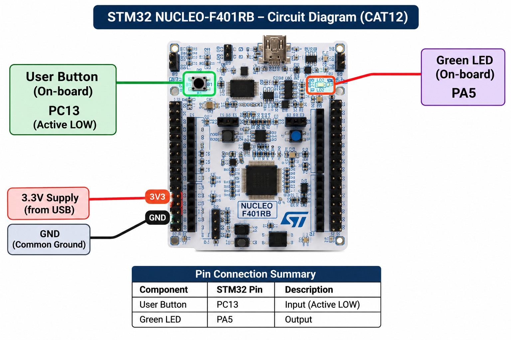

# TASK 12B – On-board Switch Control with State Remembrance

| **Field** | **Description** |
|---|---|
| **EXP** | CAT12 – Task 2 |
| **DATE** | 14/10/26 |
| **NAME OF EXP** | On-board Switch Control with State Remembrance |
| **HARDWARE SETUP / PLATFORM** | NUCLEO-F401RB development board, STM32F401RB Cortex-M4 microcontroller, onboard user LED LD2 connected to PA5 and onboard USER pushbutton B1 connected to PC13. STM32CubeMX and Keil MDK-ARM IDE with STM32 HAL. |
| **TASK NO** | Task 2 |

### Circuit Diagram

The onboard USER pushbutton B1 is connected to PC13 and the onboard LED LD2 is connected to PA5. Both components are available directly on the NUCLEO-F401RB board. No external wiring is required.

### Core Logic / Pseudocode / Code Base

- Configure PA5 as a GPIO output for LED control.
- Configure PC13 as a GPIO input to read the onboard USER button.
- Read the button state, considering that the button is active-low.
- Apply a 20 ms debounce interval to validate button presses.
- Toggle the LED state once when a valid button press is detected.
- Maintain the LED's new state after the button is released.

**Code Base:** `Core/Src/main.c`

**Development Files:** STM32CubeMX `.ioc` configuration file, Keil MDK-ARM project, STM32 HAL drivers and startup files.

### INFERENCE

The onboard pushbutton was successfully used to control the LED. The LED state toggles once for each valid button press and remains in that state after release. The experiment demonstrates GPIO input handling, active-low switch detection, debouncing and state retention.