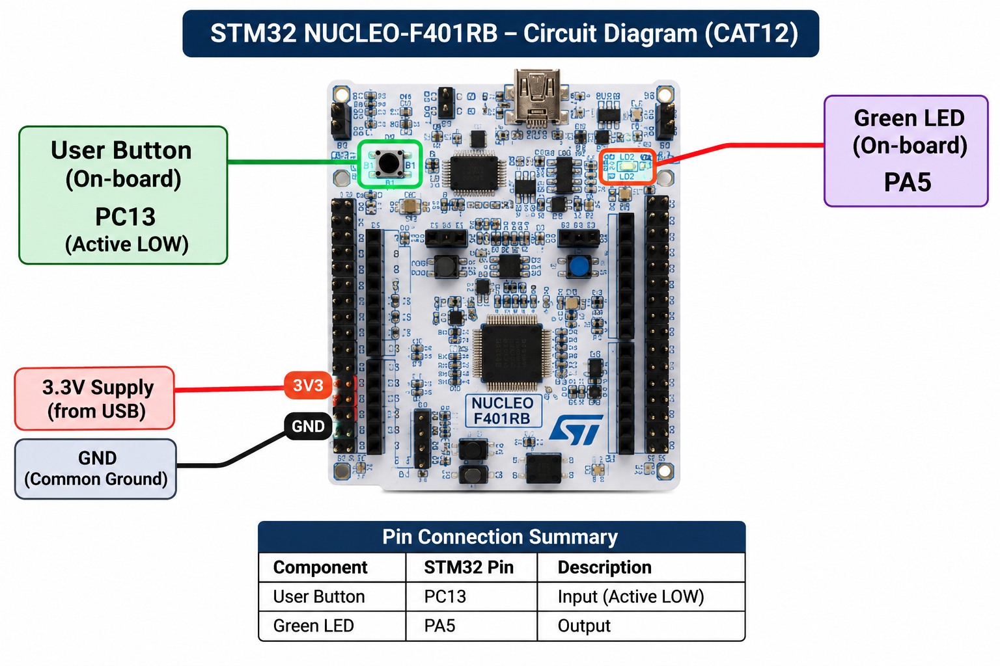

# TASK 12C – Short-Press and Long-Press Detection

| **Field** | **Description** |
|---|---|
| **EXP** | CAT12 – Task 3 |
| **DATE** | 14/10/26 |
| **NAME OF EXP** | Short-Press and Long-Press Detection |
| **HARDWARE SETUP / PLATFORM** | NUCLEO-F401RB development board, STM32F401RB Cortex-M4 microcontroller, onboard user LED LD2 connected to PA5 and onboard USER pushbutton B1 connected to PC13. STM32CubeMX and Keil MDK-ARM IDE with STM32 HAL. |
| **TASK NO** | Task 3 |

### Circuit Diagram

The onboard USER pushbutton B1 is connected to PC13 and the onboard LED LD2 is connected to PA5. Both components are available directly on the NUCLEO-F401RB board. No external wiring is required.

### Core Logic / Pseudocode / Code Base

- Configure PA5 as a GPIO output and PC13 as a GPIO input.
- Read the active-low button state and apply a 20 ms debounce interval.
- Record the button press start time using `HAL_GetTick()`.
- Detect the button release and calculate the total press duration.
- Classify the press based on a 1000 ms threshold:
  - **Short press (< 1000 ms):** Toggle the LED state.
  - **Long press (≥ 1000 ms):** Turn the LED OFF.
- Continue monitoring the button for subsequent presses.

**Code Base:** `Core/Src/main.c`

**Development Files:** STM32CubeMX `.ioc` configuration file, Keil MDK-ARM project, STM32 HAL drivers and startup files.

**Note:** The 1000 ms threshold and the corresponding LED actions describe the implemented solution. They are implementation choices because the question sheet does not specify an exact duration threshold or output actions.

### INFERENCE

The system successfully distinguishes short and long button presses by measuring the duration of each press. Different LED actions are performed depending on the detected duration. The experiment demonstrates GPIO input handling, button debouncing, time measurement using `HAL_GetTick()` and duration-based decision-making.