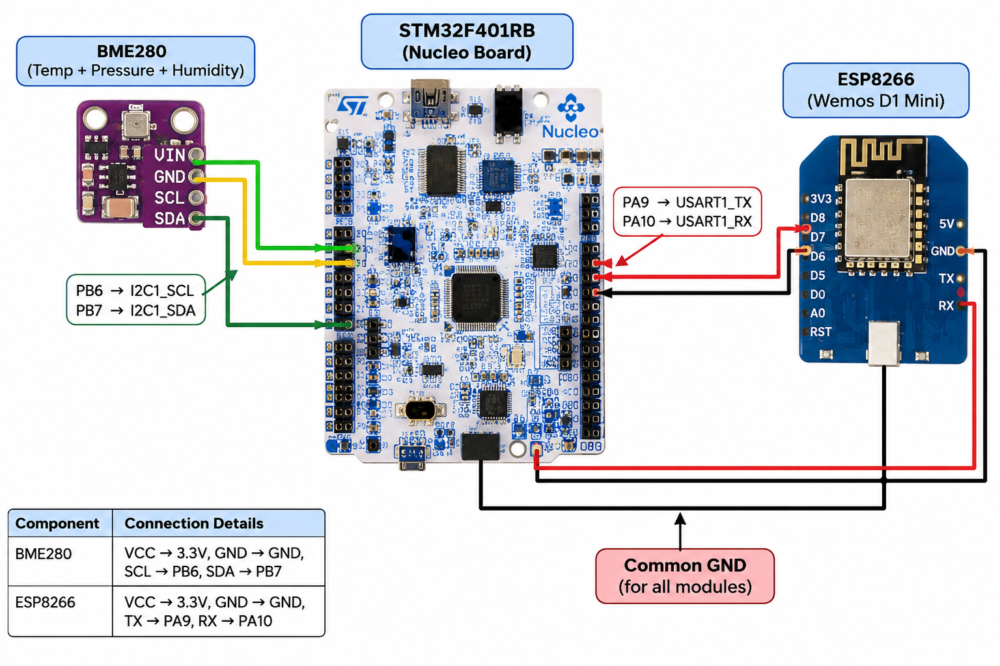

## EXP
CAT 13

## DATE
To be updated

## NAME OF EXP
Sensor Interfacing(BME280) - STM32(Debug) - ESP8266(Wi-Fi) HTTP - Node Analytics

BME280 Sensor Interfacing Using I2C and Bosch Sensor API

## HARDWARE SETUP / PLATFORM
- **Development Board:** STM32 NUCLEO-F401RB
- **Microcontroller:** STM32F401RB
- **Environmental Sensor:** BME280 (Temperature, Pressure and Humidity)
- **Wi-Fi Module:** Wemos ESP8266
- **Communication Interfaces:** I2C and UART
- **Software Platform:** STM32CubeMX, Keil MDK-ARM and PuTTY
- **Monitoring Interface:** Web browser

## TASK NO
TASK 13

## Circuit Diagram

### Pin Connections

| Component | Pin | STM32 NUCLEO-F401RB |
|---|---|---|
| BME280 | VCC | 3.3V |
| BME280 | GND | GND |
| BME280 | SCL | PB6 (I2C1_SCL) |
| BME280 | SDA | PB7 (I2C1_SDA) |
| ESP8266 | RX | PA9 (USART1_TX) |
| ESP8266 | TX | PA10 (USART1_RX) |
| ESP8266 | GND | Common GND |

## Core Logic / Pseudocode / Code Base

1. Initialize the STM32 system clock, GPIO, I2C1, USART1 and USART2 peripherals.
2. Initialize the BME280 sensor using the I2C interface and Bosch Sensor API. The program checks the sensor at address `0x76`, with `0x77` as the fallback address.
3. Configure USART1 for communication between the STM32 and ESP8266 using AT commands.
4. Configure the ESP8266 in Wi-Fi station mode and connect it to the configured wireless network.
5. Start a TCP server on port 80 using the ESP8266.
6. When a browser sends an HTTP request, the STM32 reads the request received through USART1.
7. The STM32 communicates with the BME280 through I2C, obtains temperature, pressure and humidity readings, and prepares the response.
8. The ESP8266 sends the generated HTML page to the browser through the TCP connection.
9. The webpage displays the sensor readings and refreshes automatically every 5 seconds.
10. USART2 is used to transmit debugging information to the serial monitor through PuTTY.

**Communication Interfaces:**
- I2C1 – STM32 to BME280.
- USART1 – STM32 to ESP8266.
- USART2 – STM32 to serial debugging monitor.

## INFERENCE

The BME280 sensor was successfully interfaced with the STM32 NUCLEO-F401RB board using the I2C communication protocol and Bosch Sensor API. Temperature, pressure and humidity readings were acquired and processed by the microcontroller.

The Wemos ESP8266 was successfully interfaced through UART communication and configured to host an HTTP server. The sensor readings were made accessible through a web browser over Wi-Fi, with automatic webpage updates.

The experiment was successfully tested through both software execution and physical hardware implementation.