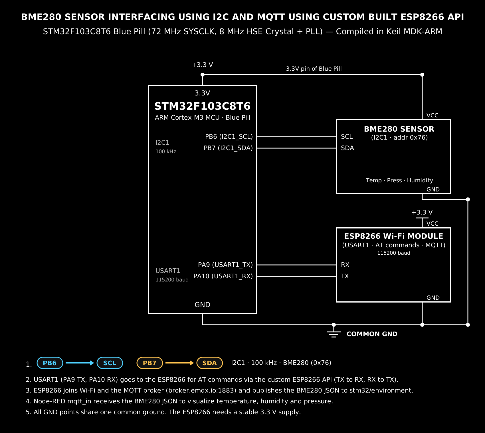

# EXPERIMENT DETAILS

**EXP:** CONTINUOUS ASSESMENT 14

**DATE:** 27/10/2026 (Week 13)

**NAME OF EXP:** BME280 Sensor Interfacing Using I²C and MQTT Using a Custom-Built ESP8266 API

**HARDWARE SETUP / PLATFORM:** STM32F103C8T6 "Blue Pill" running at 72 MHz SYSCLK (8 MHz HSE crystal + PLL ×9), configured in STM32CubeMX and compiled in Keil MDK-ARM with the STM32 HAL libraries. BME280 sensor on I²C1, ESP8266 (Wemos D1 Mini) on USART1, and a PuTTY terminal on USART2 at 115200 baud, 8-N-1. The MQTT layer is the custom `ESPLib` driver supplied with the exercise.

---

## TASK 14 : Environmental Sensing over I²C and MQTT

### 1. Circuit Diagram

The system is a chain of three parts. The BME280 hangs on the STM32's I²C1 bus as a single slave at address `0x76`, so the two signal lines PB6 (SCL) and PB7 (SDA) are all it needs, plus 3.3 V and ground. The ESP8266 is not a sensor but a modem: it is connected to USART1 on PA9/PA10 at 115200 baud and is driven entirely by AT commands from the custom library, which is what turns the STM32's readings into MQTT traffic on the network. USART2 is left free for the PC so the operator can watch the whole pipeline on a terminal while the network side is running.

Because both peripherals share the same 3.3 V rail and the same ground, the wiring is short: one bus for the sensor, one bus for the modem, and a common ground that both use as their reference. The onboard LED on PC13 is used as the control output, driven active-low — a logic 0 lights it, which is the Blue Pill's own convention.



*Figure 1 — BME280 on I²C1 (PB6/PB7, 0x76) and the ESP8266 on USART1 (PA9/PA10) with a common 3.3 V rail and common ground. USART2 goes to the PC for the debug terminal.*

- **Development Board:** STM32F103C8T6 "Blue Pill", 72 MHz SYSCLK
- **Sensor:** BME280 (temperature, pressure, humidity), I²C address `0x76` (SDO tied low)
- **Sensor Bus:** I²C1 — PB6 (SCL), PB7 (SDA), 100 kHz standard mode, 7-bit addressing
- **Wi-Fi Modem:** ESP8266 (Wemos D1 Mini) on USART1 — PA9 (USART1_TX) → RX, PA10 (USART1_RX) ← TX, 115200 baud
- **Debug Interface:** USART2 — PA2 (TX) / PA3 (RX) to the PC terminal
- **Control Output:** PC13 onboard LED, active-low (RESET = ON, SET = OFF)
- **Power:** 3.3 V and GND common to sensor and modem

| Device | STM32 pin | Function |
| --- | --- | --- |
| BME280 SCL | PB6 (I2C1_SCL) | I²C clock, 100 kHz |
| BME280 SDA | PB7 (I2C1_SDA) | I²C data |
| BME280 VCC / GND | 3.3 V / GND | Power and reference |
| ESP8266 RX | PA9 (USART1_TX) | AT commands out |
| ESP8266 TX | PA10 (USART1_RX) | Replies and MQTT data in |
| ESP8266 VCC / GND | 3.3 V / GND | Power and reference |
| PC terminal | PA2 / PA3 (USART2) | Debug printout |

### 2. Working

**Pipeline overview.** The firmware reads compensated temperature, pressure and humidity from the BME280 over I²C, formats them as a JSON payload, and publishes that payload to an MQTT topic through the ESP8266. In the other direction it subscribes to a control topic, and a message arriving there switches the onboard LED. Node-RED subscribes to the same topic and plots the readings.

**Start-up sequence.** After the HAL, clock and peripheral initialisation, the firmware waits 2 s so the modem's own boot is finished, then:

1. **BME280 initialised** — the Bosch driver is bound to the STM32 HAL through three callbacks: an I²C read, an I²C write and a microsecond delay. The read and write callbacks wrap `HAL_I2C_Mem_Read` / `HAL_I2C_Mem_Write` with the 8-bit register address size, and the delay callback converts microseconds to `HAL_Delay` milliseconds. `bme280_init()` reads the chip ID; the result is printed as either `Driver Initialized Successfully!` or `Communication Failed!`.
2. **Measurement settings applied** — humidity oversampling 1×, pressure 16×, temperature 2×, IIR filter coefficient 16, standby time 62.5 ms, and the sensor put into **normal** mode, so it measures continuously and the latest compensated values are always available.
3. **ESP8266 initialised** in station mode on USART1, then joined to the network with the SSID and password compiled into the firmware.
4. **TCP socket opened** to the broker — `broker.emqx.io` on port `1883`, the standard unencrypted MQTT port, using `ESP8266_portConnect("TCP", ...)`.
5. **MQTT CONNECT packet sent** with client ID `STM32_BME280_Node_SNUC_01`, keep-alive 500 s and the clean-session flag, then a **SUBSCRIBE** on `stm32/control` at QoS 0.

**Main loop.** Two things happen continuously:

- **Publish every 5 seconds.** The loop compares `HAL_GetTick()` against the last publish time, so the period is measured with the millisecond tick rather than a blocking delay. On each tick `bme280_get_sensor_data(BME280_ALL, ...)` returns all three compensated values, which are formatted with `snprintf` into a 128-byte buffer and published to `stm32/environment` at QoS 0:

```
{"status":"success","temperature":28.28,"humidity":77.96,"pressure":1013.58}
```

The driver returns pressure in pascals, so the payload divides it by 100 to report hectopascals — the unit weather services and Node-RED gauges use.

- **Receive control messages.** `MQTTDataHandler(rxTopic, rxMsg)` empties the library's receive queue into two buffers. A non-empty message is printed to the terminal between separator lines, and the payload is checked for `ON` or `OFF`, which drive PC13 through `HAL_GPIO_WritePin`. The buffers are cleared afterwards so the same message is not acted on twice.

**Library files.** Two files from the shared repository carry the network side — `ESPLib.c` and `ESPLib.h` — added to the project under the `Application/User/Core` group with `Core/Inc` on the include path, alongside the Bosch `bme280.c` driver. The MQTT packet building, the AT command exchange and the incoming `+IPD` parsing all live inside that library, which is why `main.c` contains only the application logic.

**Configuration, line by line:**

- **`ClockSpeed = 100000` on I2C1** — 100 kHz standard mode. The BME280 supports fast mode, but the pull-up resistors on a typical breakout suit 100 kHz, and the readings are only needed every five seconds, so there is nothing to gain from going faster.

- **`bme_i2c_addr = BME280_I2C_ADDR_PRIM << 1`** — the Bosch driver expects the 7-bit address (`0x76`), while the STM32 HAL wants it shifted left into an 8-bit read/write byte, giving `0xEC`. This one line is the most common source of "Communication Failed" errors.

- **`PLL_MUL9` on an 8 MHz HSE** — 8 MHz × 9 = 72 MHz SYSCLK, with APB1 divided by 2. The UART baud rates are derived from these clocks, so a wrong PLL setting shows up as garbled modem traffic rather than as an obvious fault.

- **`BME280_POWERMODE_NORMAL`** — forced mode would put the sensor to sleep between measurements and require a re-trigger each time; normal mode keeps it cycling on its own standby interval.

- **`keepAlive = 500`, `connectFlag = CleanSession`** — the broker drops the session if no packet arrives for 500 s, which is far longer than the 5 s publish period, and the clean-session flag means the broker keeps no state from an earlier run, so each demo starts from a known point.

### 3. Expected output on the terminal

```
--- Starting STM32 IoT Environmental Monitoring Pipeline ---
[BME280]: Driver Initialized Successfully!
Initializing ESP8266...
Connecting to Wi-Fi...
Wi-Fi Connected!
Connecting to Broker...
MQTT Broker Connected!
Subscribed to stm32/control!
[BME280 TELEMETRY PUBLISHED]: {"status":"success","temperature":28.28,"humidity":77.96,"pressure":1013.58}
[BME280 TELEMETRY PUBLISHED]: {"status":"success","temperature":28.31,"humidity":77.90,"pressure":1013.55}
----------------------------
[RECEIVED TOPIC]: stm32/control
[RECEIVED MSG]: ON
----------------------------
```

The first seven lines appear once at start-up, one telemetry line every five seconds, and the separator block whenever a control message arrives. Values will differ with the room's conditions — the point is that the numbers track the environment and that pressure sits near 1013 hPa at sea level.

### 4. Node-RED analytics

On the Node-RED side an `mqtt in` node subscribes to `stm32/environment` with the same broker (`broker.emqx.io:1883`), a `json` node parses the payload, and the three fields feed gauges or a chart for temperature, humidity and pressure. For control, an `inject` node sending `ON` or `OFF` through an `mqtt out` node to `stm32/control` switches the Blue Pill's LED from the dashboard.

### 5. Inference

The pipeline works end to end: the BME280 answers on I²C, the Bosch driver compensates the raw ADC counts into real units, the JSON payload reaches the broker over the ESP8266's TCP socket, and Node-RED plots the same numbers that the terminal shows — so the reading, the formatting and the network path are all consistent. Driving the LED from `stm32/control` proves the link is bidirectional rather than a one-way upload.

Two details are worth noting for the viva. The driver reports pressure in pascals, which is why the payload divides by 100 before publishing in hPa; publishing pascals would put the gauge at 101358. And the "Wi-Fi Connected!" and "MQTT Broker Connected!" lines are printed by the application after the library calls return, not read back from the modem's reply, so a broker-side check is the real confirmation that the connection succeeded.

---

