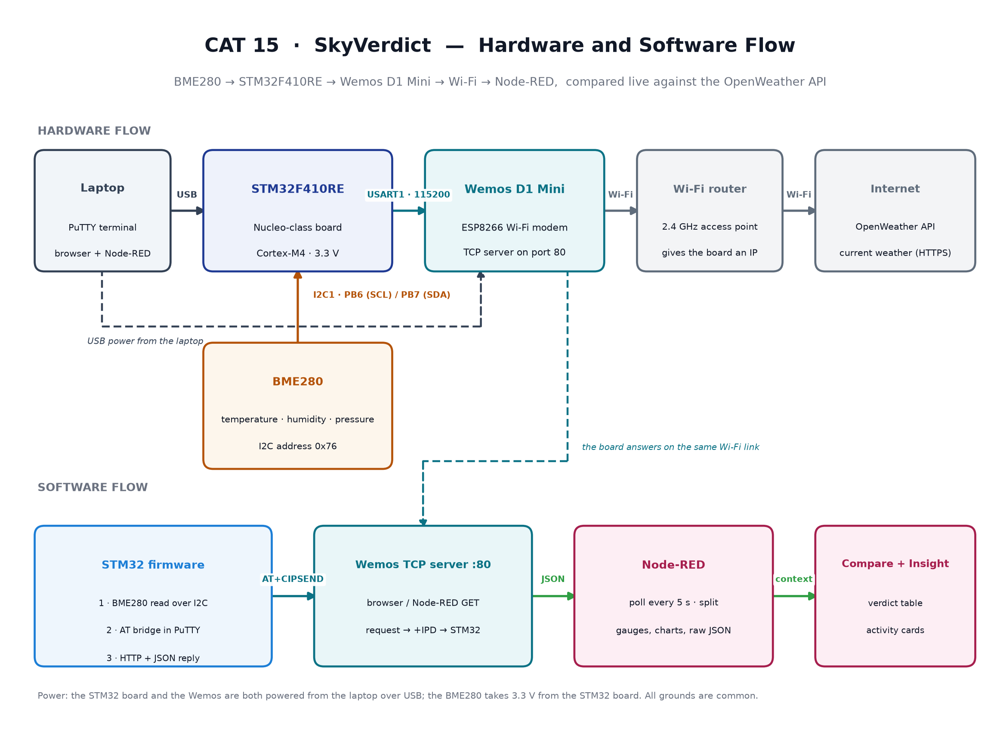

# EXPERIMENT DETAILS

**EXP:** CONTINUOUS ASSESMENT 15

**DATE:** 12/11/2026 (Week 15)

**NAME OF EXP:** SkyVerdict — a desk-level BME280 weather station that checks its own readings against the OpenWeather API in Node-RED

**HARDWARE SETUP / PLATFORM:** STM32F410RE board (Cortex-M4, 3.3 V logic) with a BME280 sensor on I²C1 and a Wemos D1 Mini (ESP8266) on USART1. The board is powered from the laptop over USB, the Wemos from a second USB cable, and the BME280 at 3.3 V from the STM32 board. Firmware built with STM32CubeMX + Keil MDK on the HAL libraries; Node-RED runs on the laptop with the node-red-dashboard nodes and an OpenWeather API key.

---

## 1. What the project does

A BME280 sensor on the STM32 measures the temperature, humidity and pressure of the room. The STM32 does not send that data anywhere by itself — it answers a web request with the readings in JSON, using the ESP8266 as its Wi-Fi modem. Node-RED then does two things in parallel: it asks the board for a fresh reading every few seconds, and it asks the OpenWeather API for the weather outside. It puts the two side by side on one dashboard, decides whether they agree, and finally turns the numbers into a plain-language suggestion of what to do that morning.

In one sentence: **a local sensor versus the internet, compared on one dashboard.** The project is called **SkyVerdict** because that comparison is the point — the board reads the sky over your desk and returns a verdict on what the internet says the weather is.

## 2. Hardware flow

The laptop is the hub. One USB cable powers and programs the STM32, a second USB cable powers the Wemos, and the laptop's browser is where the dashboard lives. The BME280 sits on the STM32's I²C bus and takes its 3.3 V from the board itself, so it needs no separate supply. The Wemos is the only device that leaves the desk: it joins the Wi-Fi router, gets an IP address, and from that moment the STM32 is reachable from any browser or from Node-RED on the same network.

*Figure 1 — the hardware lane on top and the software lane below. The BME280 feeds the STM32 over I²C, the STM32 talks AT commands to the Wemos over USART1, and the Wemos carries the readings onto the Wi-Fi network, where Node-RED collects them and compares them with OpenWeather.*

| Device | Connects to | Notes |
| --- | --- | --- |
| BME280 SCL | PB6 (I2C1_SCL) | I²C bus, 100 kHz |
| BME280 SDA | PB7 (I2C1_SDA) | I²C bus, address `0x76` |
| BME280 VCC / GND | 3.3 V / GND on the STM32 board | Powered from the board |
| Wemos RX | PA9 (USART1_TX) | AT commands from the STM32 |
| Wemos TX | PA10 (USART1_RX) | Replies and incoming HTTP requests |
| Wemos power | its own USB cable to the laptop | 3.3 V logic; never 5 V on its pins |
| STM32 | USB cable to the laptop | Power, programming and the PuTTY terminal |

Two practical points carried over from the wiring: all grounds are common, and the Wemos is deliberately on its own USB supply rather than the board's 3.3 V pin, because Wi-Fi transmit bursts draw far more current than that pin can give.

## 3. Software flow

**On the STM32** the firmware runs in three stages, one after the other:

1. **Sensor stage** — the BME280 is initialised over I²C and one reading is printed to the PuTTY terminal, so the sensor is proven before any networking starts.
2. **Bridge stage** — the STM32 becomes a transparent pipe between PuTTY and the Wemos. AT commands typed in the terminal go to the modem, and the modem's replies come back on screen, which is how the board is joined to Wi-Fi and how the TCP server is started.
3. **Serving stage** — the Wemos forwards every incoming browser request to the STM32, the STM32 reads the sensor and replies with a complete HTTP response whose body is a small JSON document. From here the board behaves like a tiny web server that only speaks sensor data.

The receive path on USART1 is interrupt driven with a 1024-byte ring buffer, which is what allows a several-hundred-byte HTTP request to arrive in one burst without losing bytes. Readings are cached for a short time so a burst of requests does not re-read the sensor each time.

**On the laptop** Node-RED is organised into four working tabs, plus the dashboard itself:

| Node-RED tab | What it does |
| --- | --- |
| **BME280 Dashboard** | Polls the board on a timer, requests the JSON, splits it into three values and shows them on gauges, a chart and a "latest values" panel; a debug node keeps the raw JSON visible |
| **OpenWeather** | Every 10 minutes calls the OpenWeather API for the local area and extracts temperature, humidity, pressure, weather trend and conditions for the same kind of display |
| **Compare (verdict)** | Takes the newest board reading and the newest API reading, computes the difference for each quantity, and marks it as a match or an expected offset; feeds the verdict table and three comparison charts |
| **Insight** | Turns the current conditions into a ranked list of morning activities, scored out of 100, using temperature, humidity, dew point and the gap between them |

**How a single reading travels:** BME280 → I²C → STM32 → AT commands → Wemos → Wi-Fi → HTTP request from Node-RED → JSON → split into three values → gauges and charts → compared with the API → verdict and suggestion.

## 4. What the dashboard shows

The dashboard is a single page with three sections. **Live readings** holds three gauges fed by the board — in the captured run 28.28 °C, 77.96 %RH and 1013.58 hPa. **OpenWeather now** holds the same three gauges fed by the API (26.08 °C, 79 %, 1014 hPa) with a line chart of the last few hours and a conditions line naming the location. **Verdict** is a table that compares the two sets and says what the difference means: pressure agrees to within about 0.3 % once both are reduced to sea level, while temperature sits about 8 % higher at the board because the sensor is measuring the air beside the desk rather than the air at two metres over open ground. The **Insight** card then ranks four morning options from that same data — for example outdoor yoga first at 91/100, a run second at 65/100, and dew photography last at 25/100 because the dew-point spread is small.

## 5. Inference

The project closes the loop from a physical measurement to a decision. The BME280's readings leave the STM32 as plain JSON over the ESP8266's Wi-Fi link, Node-RED picks them up without any custom protocol, and the same dashboard holds the internet's opinion next to the sensor's. Comparing the two is what makes the numbers meaningful: pressure matches closely because both sides are reduced to sea level, while temperature and humidity differ in a way that has a physical explanation rather than a fault. Turning that comparison into a ranked activity list is the last step — the data stops being a table and becomes something a person can act on.

---
