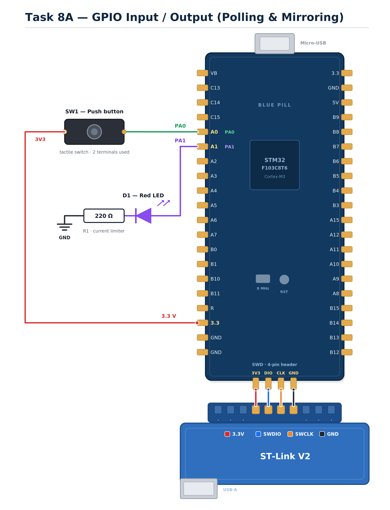

EXPERIMENT DETAILS
EXP: CONTINUOUS ASSESSMENT 8A

DATE: 18/09/2026

NAME OF EXP: STM32 GPIO Bring-Up and Switch-Controlled LED

HARDWARE SETUP / PLATFORM: STM32 Development Board (Blue Pill/Nucleo) + STM32CubeMX + Keil MDK (HAL Libraries)

TASK 8A : GPIO Input/Output
1. Circuit Diagram
The experiment demonstrates basic GPIO input and output operations using the STM32 microcontroller. A push-button is configured as a digital input to control the state of an LED configured as a digital output.

Development Board: STM32 Development Board (Blue Pill/Nucleo)
Microcontroller: STM32 (ARM Cortex-M)
GPIO Port: Port A
GPIO Pin: PA0 (Push-button input with pull-down resistor); PA1 (LED output)
Power Supply: Powered via ST-Link or USB
Ground: common GND shared between the button and LED circuits
Circuit Diagram

circuit.png is a reference sketch of the connections listed above.

2. Core Logic / Pseudocode / Code Base
Working Principle:

The STM32 microcontroller uses the HAL (Hardware Abstraction Layer) library. Pin PA0 is configured as a digital input with an internal pull-down resistor, ensuring a stable LOW state when the button is not pressed. Pin PA1 is configured as a push-pull digital output. The main loop continuously polls the state of PA0 using HAL_GPIO_ReadPin(). If the pin reads GPIO_PIN_SET (button pressed), the firmware uses HAL_GPIO_WritePin() to set PA1 HIGH, lighting the LED. Otherwise, PA1 is set LOW, turning the LED off.

Pseudocode:

Initialize the STM32 HAL library and system clock.
Configure Port A Pin 0 (PA0) as an input with a pull-down resistor for the push-button.
Configure Port A Pin 1 (PA1) as a push-pull output for the LED.
Enter the infinite main loop.
Read the digital state of the push-button at PA0.
Check if the button state is high (pressed).
If pressed, set the LED output at PA1 to high to turn it on.
If not pressed, set the LED output at PA1 to low to turn it off.
Repeat the loop to continuously monitor the button state.

Code Base:

The program is written in Embedded C using STM32CubeMX for initialization and Keil MDK for compilation, and the source file is kept in this folder.

main.h and HAL libraries provide the necessary hardware definitions.
MX_GPIO_Init() configures PA0 as input with pull-down and PA1 as output.
HAL_GPIO_ReadPin() polls the state of PA0.
HAL_GPIO_WritePin() sets the state of PA1 based on the input read.
main() initializes the HAL, configures the clock, and runs the infinite polling loop.

3. Inference
The LED successfully mirrored the state of the push-button in real-time. The use of the internal pull-down resistor on PA0 prevented floating input states, ensuring reliable button detection. The experiment demonstrated basic polling-based GPIO input and output operations using the STM32 HAL functions.