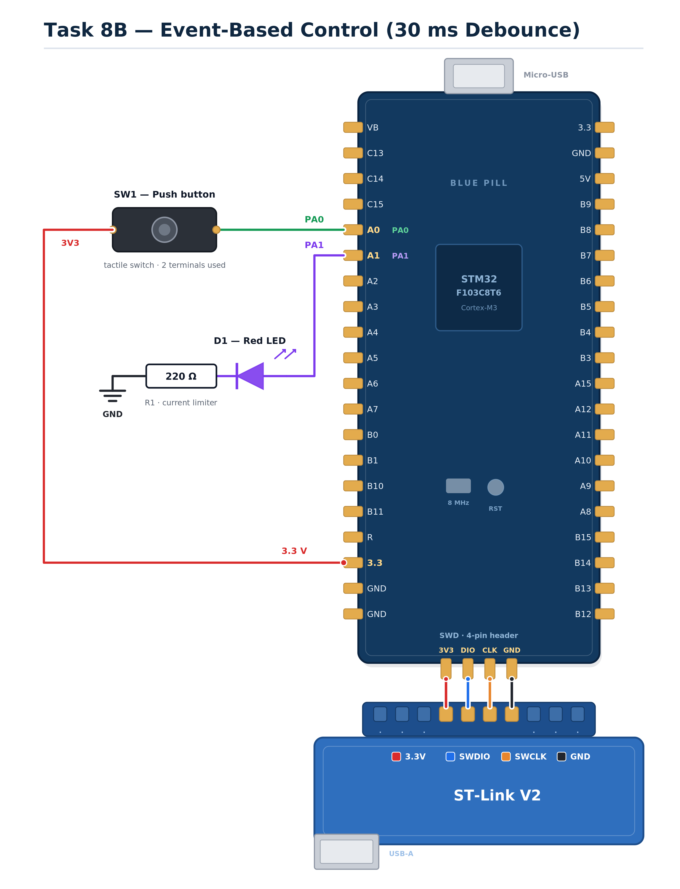

EXPERIMENT DETAILS
EXP: CONTINUOUS ASSESSMENT 8C

DATE: 18/09/2026

NAME OF EXP: STM32 Short Press vs Long Press Classification

HARDWARE SETUP / PLATFORM: STM32 Development Board (Blue Pill/Nucleo) + STM32CubeMX + Keil MDK (HAL Libraries)

TASK 8C : Short Press vs Long Press
1. Circuit Diagram
The experiment demonstrates time-based event classification using a non-blocking state machine. A push-button is configured as an input to differentiate between a short press and a long press, controlling the LED state and a continuous blinking mode.

Development Board: STM32 Development Board (Blue Pill/Nucleo)
Microcontroller: STM32 (ARM Cortex-M)
GPIO Port: Port A
GPIO Pin: PA0 (Push-button input with pull-down resistor); PA1 (LED output)
Power Supply: Powered via ST-Link or USB
Ground: common GND shared between the button and LED circuits
Circuit Diagram

circuit.png is a reference sketch of the connections listed above.

2. Core Logic / Pseudocode / Code Base
Working Principle:

The firmware classifies a button press according to how long the button remains pressed. To strictly avoid blocking delays, the system uses `HAL_GetTick()` to measure the millisecond time base. The debounced switch logic detects state changes. When a press begins, the start time is recorded. When released, the duration is calculated. If the duration is 1 second or more, the system enters a continuous blinking mode, and the LED toggles every 250 ms based on a non-blocking timer. If the duration is less than 1 second, the LED is toggled, or the blinking mode is stopped if it was already active.

Pseudocode:

Initialize the STM32 HAL library, clock, and GPIO pins (PA0 input, PA1 output).
Define constants for debounce time (30 ms), long press threshold (1000 ms), and blink period (250 ms).
Initialize state variables for debouncing, press start time, blinking mode flag, and last blink time.
Enter the infinite main loop.
Call the non-blocking debounce function to check if the button state changed.
If the debounced state changed to pressed, record the current millisecond tick as the press start time.
If the debounced state changed to released, calculate the total duration of the press.
Check if the duration is greater than or equal to the long press threshold.
If it is a long press, enable the continuous blinking mode and record the current tick.
If it is a short press, check if the system is currently blinking.
If blinking, stop the blinking mode.
If not blinking, toggle the LED state.
Independently check if the blinking mode is active and the time since the last blink exceeds the blink period.
If true, update the last blink time and toggle the LED.
Repeat the loop.

Code Base:

The program is written in Embedded C using STM32CubeMX and Keil MDK.

MX_GPIO_Init() configures PA0 as input with pull-down and PA1 as output.
Switch_Update() handles non-blocking debounce using HAL_GetTick().
HAL_GetTick() provides the time base for both the long-press duration calculation and the continuous blinking timer.
main() contains the core state machine that classifies the press based on duration and manages the non-blocking blink generator.
HAL_GPIO_TogglePin() is used to control the LED output.

3. Inference
The system successfully distinguished between short and long presses using the HAL_GetTick() millisecond time base without blocking the CPU. Short presses toggled the LED or stopped the blinking, while a long press successfully engaged the continuous blinking state. The experiment demonstrated robust, non-blocking time-based event classification essential for responsive embedded systems.