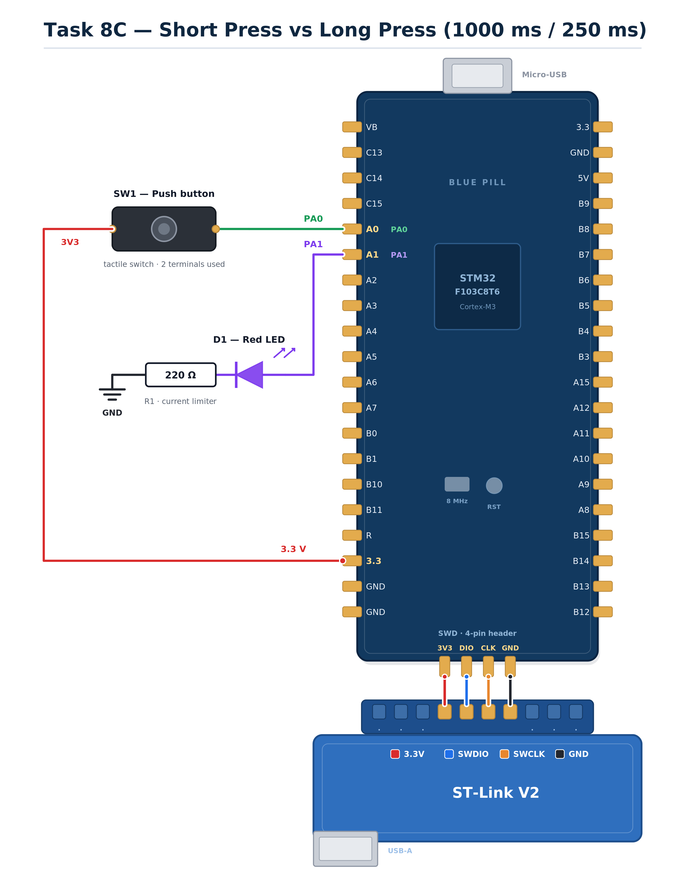

EXPERIMENT DETAILS
EXP: CONTINUOUS ASSESSMENT 8B

DATE: 18/09/2026

NAME OF EXP: STM32 Event-Based Control (Switch Debouncing)

HARDWARE SETUP / PLATFORM: STM32 Development Board (Blue Pill/Nucleo) + STM32CubeMX + Keil MDK (HAL Libraries)

TASK 8B : Event-Based Control
1. Circuit Diagram
The experiment demonstrates event-based control using a non-blocking software debounce algorithm. A push-button is configured as an input to toggle the state of an LED configured as an output.

Development Board: STM32 Development Board (Blue Pill/Nucleo)
Microcontroller: STM32 (ARM Cortex-M)
GPIO Port: Port A
GPIO Pin: PA0 (Push-button input with pull-down resistor); PA1 (LED output)
Power Supply: Powered via ST-Link or USB
Ground: common GND shared between the button and LED circuits
Circuit Diagram

circuit.png is a reference sketch of the connections listed above.

2. Core Logic / Pseudocode / Code Base
Working Principle:

In this task, the LED state is toggled upon a valid button press rather than mirroring the button state continuously. Mechanical switches suffer from physical bouncing, which causes multiple rapid transitions when pressed. To solve this in software, a non-blocking state machine is implemented. The program tracks the raw state of the pin and a stable state. When the raw input changes, a timestamp (`lastChange`) is updated using `HAL_GetTick()`. The program only accepts the new state if it remains stable for a defined duration (30 ms). If accepted, and the button was pressed, `HAL_GPIO_TogglePin()` is called to flip the LED state.

Pseudocode:

Initialize the STM32 HAL library, clock, and GPIO pins (PA0 input, PA1 output).
Define a debounce delay period (30 milliseconds).
Initialize variables to track the raw pin state, the stable debounced state, and the last time the raw state changed.
Enter the infinite main loop.
Read the current raw digital state of the push-button at PA0.
Check if the raw state is different from the last recorded raw state.
If it changed, update the last raw state and record the current millisecond tick.
Check if the raw state is different from the stable state, and if the time since the last change is greater than the debounce delay.
If the state has been stable long enough, accept it as the new stable state and flag that a valid change occurred.
If a valid change occurred and the new stable state is high (pressed), toggle the LED output at PA1.
Repeat the loop.

Code Base:

The program is written in Embedded C using STM32CubeMX and Keil MDK.

MX_GPIO_Init() configures PA0 as input with pull-down and PA1 as output.
Switch_Update() acts as a non-blocking debounce function. It uses HAL_GetTick() to measure stability time without using HAL_Delay().
HAL_GPIO_ReadPin() polls the raw input state.
HAL_GPIO_TogglePin() flips the state of the LED only when the debounced state transitions to pressed.
main() calls Switch_Update() continuously in the loop and applies the toggle logic.

3. Inference
The LED toggled exactly once per physical press. The non-blocking software debounce logic successfully filtered out the mechanical bouncing of the push-button without halting the CPU. The experiment demonstrated the difference between level-based polling and edge-based event detection, highlighting the importance of robust input handling in embedded systems.