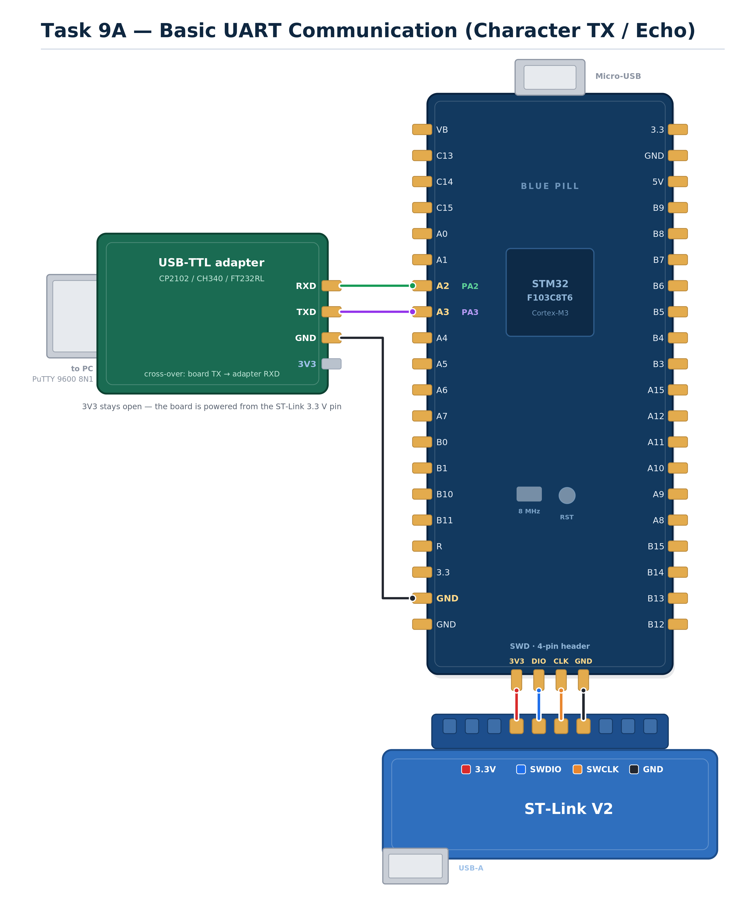

# EXPERIMENT DETAILS

**EXP:** CONTINUOUS ASSESMENT 9

**DATE:** 28/09/2026

**NAME OF EXP:** STM32 UART Command Controlled LED

**HARDWARE SETUP / PLATFORM:** STM32 Blue Pill (STM32F103C8T6) + STM32CubeMX + Keil MDK with HAL libraries, USART2 on PA2/PA3 through a USB-to-TTL converter to a PC running PuTTY, onboard LED on PC13

---

## TASK 9A : Basic UART Communication

### 1. Circuit Diagram

The experiment demonstrates basic serial communication between the STM32 and a PC terminal over USART2, configured for 9600 baud 8-N-1, with the transmission paced by a hardware timer interrupt instead of a blocking loop.

- **Development Board:** STM32 Blue Pill
- **Microcontroller IC:** STM32F103C8T6 (ARM Cortex-M3)
- **UART Peripheral:** USART2, configured for 9600 baud, 8 data bits, no parity, 1 stop bit, no flow control
- **UART Pins:** PA2 (USART2_TX) to RXD of the USB-to-TTL converter; PA3 (USART2_RX) to TXD of the converter
- **Timer Peripheral:** TIM2, configured in interrupt mode to generate the periodic transmission event
- **Peripheral:** USB-to-TTL serial converter connected to a PC running PuTTY
- **Power Supply:** +5 V and +3.3 V from the ST-Link V2 programmer or from the USB-to-TTL converter
- **Ground:** common GND shared between the STM32, the ST-Link V2 and the USB-to-TTL converter

`circuit.png` is a reference sketch of the connections listed above; replace it with the Wokwi / Tinkercad capture or a hand-drawn diagram if the submission calls for one.

### 2. Core Logic / Pseudocode / Code Base

**Working Principle:**

The STM32 establishes serial communication with a PC terminal over USART2 at 9600 baud with 8 data bits, no parity and 1 stop bit. The pins PA2 and PA3 are configured by STM32CubeMX as the alternate-function TX and RX lines of USART2, and the peripheral is initialised with `MX_USART2_UART_Init()` before the main loop is entered.

Rather than transmitting in a blocking loop, a hardware timer is used as the time base. TIM2 is configured with a prescaler of 6399 and a period of 9999, so the counter produces an update event at a fixed interval; `HAL_TIM_Base_Start_IT()` starts the timer with its interrupt enabled. Each update event raises the TIM2 interrupt, which the HAL dispatches to `HAL_TIM_PeriodElapsedCallback()`.

Inside the callback the code checks that the interrupt really came from TIM2 and then calls `HAL_UART_Transmit()` to send the character `'A'` to the terminal. Because the transmission is driven by the timer interrupt, the main loop stays empty and the CPU is free between events, which is the non-blocking pattern the exercise is demonstrating.

**Pseudocode:**

1. Initialise the HAL library and configure the system clock (HSE with PLL).
2. Configure PA2 as USART2_TX and PA3 as USART2_RX in alternate-function push-pull mode.
3. Initialise USART2 at 9600 baud, 8-bit word length, 1 stop bit and no parity.
4. Initialise TIM2 with the prescaler and period values that set the transmission interval.
5. Start TIM2 in interrupt mode with `HAL_TIM_Base_Start_IT()`.
6. Enter the infinite main loop while the CPU waits for timer events.
7. On each TIM2 update interrupt, enter `HAL_TIM_PeriodElapsedCallback()`.
8. Confirm that the interrupt source is TIM2.
9. Transmit the character `'A'` over USART2 to the PC terminal with `HAL_UART_Transmit()`.
10. Return from the callback and repeat on every timer period.

**Code Base:**

The program is written in Embedded C, with the peripherals configured in STM32CubeMX and the project built in Keil MDK against the STM32 HAL library. The `.ioc` file and the generated `Core/` and `Drivers/` folders are kept with the project.

- `HAL_Init()` and `SystemClock_Config()` run at start-up and set the clock tree generated by CubeMX.
- `MX_GPIO_Init()` configures the port pins used by USART2 and the onboard LED.
- `MX_USART2_UART_Init()` sets USART2 to 9600 baud, 8-N-1, with both transmit and receive enabled.
- `MX_TIM2_Init()` configures TIM2 with `Prescaler = 6399` and `Period = 9999`, which fixes the interval between transmissions.
- `HAL_TIM_Base_Start_IT()` starts the timer with its update interrupt enabled, so the transmission is non-blocking.
- `HAL_TIM_PeriodElapsedCallback()` handles the TIM2 interrupt and calls `HAL_UART_Transmit()` to send `txChar` (`'A'`) to PuTTY.

### 3. Inference

The STM32 established serial communication with the PC terminal at 9600 baud and the character `'A'` appeared in PuTTY at regular intervals, with the main loop remaining empty throughout because the transmission was driven entirely by the timer interrupt.

Using the TIM2 update interrupt instead of a software delay gave a steady, deterministic interval between characters and left the CPU free between events, which confirmed that the timer is acting as the system time base for the UART traffic.

The experiment demonstrates UART transmission on the STM32 through the HAL library, the use of a hardware timer as a periodic interrupt source, and the difference between blocking and interrupt-driven peripheral handling.
